# 项目全景说明（Project Panorama）

> **用途**：交付给外部网页版 LLM / agent 作为唯一资料。读者不打开仓库，只读本文即可理解：项目是什么、怎么跑、有哪些页面与数据、有哪些已知问题。
> **基线**：2026-10-30，仓库 `d:\Project\knowledgeBase`，Git HEAD `43c7656`（`feat: enhance authentication and session management`）。注意：工作区含未提交改动（`/progress`、`/api/learning/*`、`db-retry`、`db-read`、`secret-crypto`、`learning-service` 等文件），本文按**当前磁盘状态**核实，而非 HEAD。
> **事实来源**：`package.json`、`src/` 逐文件读取、`docs/未完成任务清单.md`、README、以及真实运行截图（`docs/images/`）。
> **约定**：路径后的 `:行号` 指该文件当前磁盘行号；截图全部来自本地真实运行实例（非占位图）。

---

## 0. 一页速览

| 项 | 内容 |
|---|---|
| 名称 | 个人知识库（`knowledge-base`，v0.1.0，private） |
| 一句话 | 跨设备访问、自动关联、按「记忆程度」着色的个人学习知识库；把 Markdown 笔记拆成知识点，阅读即学习，忘得快的地方在图谱里变暗 |
| 目标用户 | 单个学习者（作者本人）；自托管 / 个人部署，不做团队与公开分享 |
| 形态 | 单用户 Web 应用，单口令登录，无注册、无多租户 |
| 技术栈 | Next.js `16.4.3`（App Router）+ React `19.3.0` + Tailwind CSS `4` + TypeScript `5`；Neon Serverless Postgres + Drizzle `0.45.4`；Cloudflare R2（可选）；DeepSeek（OpenAI 兼容，raw fetch） |
| 部署 | Vercel Hobby（个人非商业）；单实例假设下带进程内缓存 |
| 数据规模 | 本地样例库：4 篇文档 / 15 个知识点；设计目标为个人数千知识点 |
| 工作语言 | 界面、代码注释、文档均为简体中文 |
| 本地启动 | `npm run dev` → `http://localhost:3000`（需 `.env.local` 中 `DATABASE_URL`、`AUTH_PASSCODE`） |

---

## 1. 项目定位与目标用户

### 1.1 要解决的问题

对标 Obsidian 场景的三个痛点，逐一给出解法：

| Obsidian 痛点 | 本项目解法 | 落点（代码） |
|---|---|---|
| 知识锁在本地，跨设备需付费同步 | 部署 Vercel，浏览器即用 | 全站 |
| 归类与关联靠手动 | 导入时按标题层级拆段，提取 frontmatter 标签、正文 `[[双链]]`，自动建立三类关联边 | `src/lib/splitter.ts:53`、`src/lib/markdown.ts`、`src/lib/links.ts:12` |
| 图谱太大，看不出哪些快忘 | 力导向图节点亮度 = 记忆度（琥珀灯隐喻），可按记忆档位 / 关联类型过滤 | `src/app/graph/page.tsx:136`、`src/lib/memory.ts:121` |
| 记忆保持没有反馈 | 阅读即学习：按停留时长推进稳定度，展示记忆度与半衰期 | `src/app/api/segments/[id]/view/route.ts`、`src/lib/memory.ts:78` |
| 长文读不下去 | 导入时按标题层级拆成合适粒度的知识点，不在句中截断 | `src/lib/splitter.ts:53` |

### 1.2 目标用户画像

- 单人使用：一个口令、一份库，不需要分享链接、协作、权限体系。
- 使用节奏：导入 Markdown 笔记 → 在首页看「今日学习」→ 点进知识点阅读 → 做主动回忆自测 → 在复盘页看趋势 → 在图谱里看结构。
- 关心成本：LLM 调用有预算、缓存、护栏与用量看板，个人免费额度可长期运行。

### 1.3 明确非目标

- 多用户 / 注册体系 / 团队协作 / 公开分享
- 移动原生 App（只做响应式 Web）
- 富文本与图片为主的笔记（附件与图片仍是 Roadmap）
- 通用聊天机器人（对话只服务本库内容）

---

## 2. 技术栈与关键依赖（以 `package.json` 实际为准）

### 2.1 运行时与框架

| 层 | 技术 | 版本（`package.json`） | 用途 / 备注 |
|---|---|---|---|
| 框架 | `next` | `16.4.3` | App Router；`next.config.ts` 开启 `cacheComponents: true`、`partialPrefetching: true` |
| UI | `react` / `react-dom` | `19.3.0` / `19.3.0` | Server Components + 客户端交互组件 |
| 样式 | `tailwindcss` + `@tailwindcss/postcss` | `^4` / `^4.3.3` | CSS-first，无 `tailwind.config` |
| 语言 | `typescript` / `@types/node` | `^5` / `^22.20.5` | `npm run typecheck` = `tsc --noEmit` |
| 数据库驱动 | `@neondatabase/serverless` | `^1.2.0` | HTTP 驱动，支持 `db.batch` 原子提交 |
| ORM / 迁移 | `drizzle-orm` / `drizzle-kit` | `^0.45.4` / `^0.31.11` | `neon-http` 适配器 |
| 对象存储 | `@aws-sdk/client-s3` | `^3.1156.0` | S3 兼容接 Cloudflare R2；列入 `serverExternalPackages` |
| 图谱渲染 | `react-force-graph-2d` | `^1.29.2` | Canvas 力导向图 |
| Markdown 渲染 | `react-markdown` / `remark-gfm` | `^10.1.0` / `^4.0.1` | 阅读态渲染 |
| frontmatter | `js-yaml` | `^5.5.0` | 解析 YAML frontmatter |
| 单测 | `vitest` | `^5.0.5` | 用例在 `src/lib/__tests__/`（35 个文件）；`vitest.config.mts` 限 `maxWorkers: 2` |
| E2E | `@playwright/test` | `^1.64.1` | `e2e/auth-graph.spec.ts`，启动器 `scripts/run-e2e.mjs` |
| Lint | `eslint` / `eslint-config-next` | `^9` / `16.4.3` | `npm run lint` |

本机实际运行环境：Node `v22.20.0`（`node --version` 已核实）。

> ⚠️ **Next.js 16 与常见训练数据中的版本存在破坏性差异**。仓库根 `AGENTS.md` 明确要求：改代码前先读 `node_modules/next/dist/docs/` 对应指南。本项目的 `proxy.ts`（等价旧 middleware）、`LayoutProps<"/">` 等写法都来自该版本约定。

### 2.2 环境变量

| 变量 | 必填 | 说明 / 代码位置 |
|---|---|---|
| `DATABASE_URL` | 是 | Neon Pooled 连接串；缺失时 `src/db/index.ts:11` 抛错 |
| `AUTH_PASSCODE` | 是 | 登录口令；缺失时全站 503 / 跳登录（`src/proxy.ts:13`） |
| `SETTINGS_ENCRYPTION_KEY` | 否 | LLM Key 加密主密钥；不填则由口令派生（`.env.example` / README） |
| `R2_ACCOUNT_ID` / `R2_ACCESS_KEY_ID` / `R2_SECRET_ACCESS_KEY` / `R2_BUCKET` | 否 | 不配则不备份导入原文（`src/lib/r2.ts:12`） |
| `LLM_API_KEY` + `LLM_MODEL` | 否 | 回退配置（`src/lib/llm.ts:115`） |
| `DEEPSEEK_API_KEY` + `DEEPSEEK_MODEL` | 否 | 回退配置（`src/lib/llm.ts:119`） |

本地 `.env.local` 实际只有 `DATABASE_URL`、`AUTH_PASSCODE`（无 R2 变量）。

### 2.3 运行时架构

```
浏览器
  │  Cookie kb_session = sha256("kb-v1:" + AUTH_PASSCODE)  (HttpOnly, 30 天)
  ▼
src/proxy.ts:7            全站登录门（/login、/api/auth 放行；未登录页面 302 /login?next=…，API 401）
  ▼
App Router 页面（RSC + 客户端组件） ⇄ /api/* Route Handlers（Node runtime）
  │                                        │
  │                       ┌────────────────┼───────────────────┐
  ▼                       ▼                ▼                   ▼
src/lib/* 业务层      Neon Postgres    Cloudflare R2      DeepSeek API
(splitter/memory/     (HTTP 驱动,       (原文备份,          (raw fetch,
 links/rag/llm…)       db.batch 事务)    可选)              OpenAI 兼容)
```

要点：

- 业务逻辑集中在 `src/lib/*`，路由只做鉴权、校验与编排。
- 数据库惰性初始化：`next build` 会导入路由模块，故 `src/db/index.ts` 用 Proxy 延迟连接。
- 多表写入走 Neon HTTP batch（`src/lib/db-batch.ts`），失败整体回滚。
- 两层缓存：进程内 TTL（`src/lib/cache.ts`，带陈旧快照降级）+ 数据库 LLM 输出缓存（`llm_cache` 表，256 条上限）。
- 只读路径韧性：`src/lib/db-retry.ts` 识别瞬时故障并指数退避重试；仍失败则 `src/lib/db-read.ts` 回退陈旧快照（响应头 `X-Cache: STALE`），完全不可用返回 503。

---

## 3. 安装与运行（本仓库真实命令）

```bash
# 1) 依赖
npm install

# 2) 环境变量
copy .env.example .env.local     # Windows；Linux/macOS 用 cp
# 填入 DATABASE_URL、AUTH_PASSCODE（R2_* 可选）

# 3) 建表（Neon HTTP，顺序执行 src/db/migrations/ 下的 SQL）
npm run db:migrate               # = node --env-file=.env.local scripts/apply-migrations.mjs
npm run db:migrate:check         # 只读检查待执行迁移（--dry-run）

# 4) 开发
npm run dev                      # http://localhost:3000
```

### 3.1 `package.json` 脚本全表

| 命令 | 实际执行 | 用途 |
|---|---|---|
| `npm run dev` | `next dev` | 开发服务器（Turbopack） |
| `npm run build` | `next build` | 生产构建（**需要 `DATABASE_URL`**，见 §8 坑点） |
| `npm run start` | `next start` | 启动生产构建 |
| `npm run lint` | `eslint` | ESLint 9 |
| `npm run typecheck` | `tsc --noEmit` | 类型检查 |
| `npm run test` | `vitest run` | 单元/组件测试 |
| `npm run test:watch` | `vitest` | 监听模式 |
| `npm run test:e2e` | `node scripts/run-e2e.mjs` | Playwright 回归（首次需 `npx playwright install chromium`） |
| `npm run perf:graph` | `node scripts/measure-graph.mjs` | 图谱性能测量 |
| `npm run db:generate` | `drizzle-kit generate` | 生成迁移 SQL |
| `npm run db:migrate` | `node --env-file=.env.local scripts/apply-migrations.mjs` | 顺序执行迁移（`_kb_migrations` 记录版本，重复执行不重放） |
| `npm run db:migrate:check` | 同上 + `--dry-run` | 只读检查 |
| `npm run db:push` | `drizzle-kit push` | 直接推 schema（开发用） |
| `npm run db:studio` | `drizzle-kit studio` | 数据浏览 |

### 3.2 迁移文件（8 个）

`src/db/migrations/`：`0000_init.sql`、`0001_fearless_lightspeed.sql`、`0002_funny_tomorrow_man.sql`、`0003_charming_selene.sql`、`0004_vengeful_union_jack.sql`、`0005_skinny_war_machine.sql`、`0006_llm_calls_observability.sql`、`0007_wooden_wong.sql`（另有 `meta/`）。

### 3.3 部署（Vercel）

1. 推到 GitHub，Vercel 导入仓库；
2. 配置 `DATABASE_URL`、`AUTH_PASSCODE`（可选 `SETTINGS_ENCRYPTION_KEY`、`R2_*`）；
3. 首次部署后手工执行一次 `npm run db:migrate`（在本地指向生产库）；
4. 已知平台边界：请求体上限约 4.5MB；可能有多个实例（进程内缓存为 best-effort）。

---

## 4. 目录结构

```
knowledge-base/
├── AGENTS.md                  # 仓库规则：Next 16 文档先行 + 提示词生成规范
├── README.md                  # 使用说明、Roadmap、已知限制
├── next.config.ts             # cacheComponents / partialPrefetching / 安全响应头（含 CSP）
├── package.json
├── .env.example
├── docs/                      # 方案与治理文档（含本文与《未完成任务清单》）
│   └── images/                # 本文全部真实截图
├── e2e/auth-graph.spec.ts     # Playwright 回归
├── scripts/
│   ├── apply-migrations.mjs   # 迁移执行器（支持 --dry-run）
│   ├── gen-graph-data.mjs     # 生成 /graph?fixture= 的三档数据
│   ├── measure-graph.mjs      # 图谱性能测量
│   ├── mock-llm.mjs           # 测试用假模型服务
│   ├── perf-seed.mjs          # 压测灌数
│   └── run-e2e.mjs            # E2E 启动器
├── public/fixtures/           # 图谱压测数据（被 .gitignore 忽略，需生成）
└── src/
    ├── proxy.ts               # 认证网关
    ├── db/
    │   ├── index.ts           # Neon 连接（Proxy 惰性初始化）
    │   ├── schema.ts          # 9 张表（Drizzle）
    │   └── migrations/
    ├── lib/                   # 业务层（详见下表）
    │   ├── ui/                # contrast / geometry / theme（表现层基础）
    │   └── __tests__/         # 35 个 Vitest 文件
    ├── components/            # 10 个组件
    └── app/                   # 页面 + API Route Handlers
```

### 4.1 `src/lib` 关键模块

| 文件 | 职责 |
|---|---|
| `splitter.ts:53` | Markdown → 知识点结构化拆解（启发式，主链路；不在句中截断） |
| `markdown.ts` | frontmatter、标签、`[[双链]]` 提取 |
| `memory.ts:11/78/100/112` | 记忆曲线：参数表、稳定度推进、记忆度衰减、半衰期 |
| `links.ts:12/58` | wiki / tag / doc 三类边的重建 SQL |
| `annotations.ts` / `annotation-migrate.ts` | 标注锚定与三级重定位；段改写后迁移标注 |
| `rag.ts` | 关键词检索、片段抽取、上下文预算 `buildContextBudget()`（无向量、无 tiktoken） |
| `learner-profile.ts` | 学习者画像（SQL 下推聚合 + 派生缓存） |
| `kb-overview.ts` | 知识库概览块（助手常驻上下文，≤600 字） |
| `llm.ts` | DeepSeek 调用层（fetch / 重试 / 预算 / 分档 / 流式） |
| `llm-cache.ts` / `llm-calls.ts` | LLM 输出缓存；调用流水与日 token 护栏 |
| `agent-tools.ts` | 助手 Agent 工具定义与流式 tool_call 组装 |
| `learning-plan.ts` / `learning-service.ts` / `recall-question.ts` | 今日推荐排序、学习数据聚合、自测题生成 |
| `db-retry.ts` / `db-read.ts` / `cache.ts` | 瞬时故障重试、陈旧快照降级、进程内 TTL 缓存 |
| `secret-crypto.ts` | LLM Key 的 AES-GCM 加解密 |
| `api.ts` / `auth.ts` / `security.ts` | guard、会话、转义与安全跳转 |

### 4.2 `src/components`

| 组件 | 行号 | 用途 |
|---|---|---|
| `AppShell.tsx` | `:74`（NAV）/ `:86` | 侧边栏导航与页面骨架 |
| `DashboardPanel.tsx` | `:84` | 概览行动面板（取数在 `:55`/`:80`） |
| `TodayLearningPanel.tsx` | `:16` | 今日学习卡片 |
| `AiOverlay.tsx` | `:9` | AI 预览 / 确认浮层（preview→确认→apply） |
| `SegmentEditCard.tsx` | `:20` | 段编辑卡（含 AI 拆解 / 聚合入口） |
| `SectionEditor.tsx` | `:20` | 选区 / 锚点编辑 |
| `MemoryBadge.tsx` | `:19`/`:31` | 记忆档位灯点与徽标 |
| `ErrorState.tsx` / `InlineFeedback.tsx` | `:9` / `:21` | 页面级错误态；统一行内反馈 |
| `Skeleton.tsx` | `:2`/`:7` | 加载骨架 |

---

## 5. 页面、路由与交互流程

### 5.1 页面路由表

| 路由 | 入口文件（含行号） | 作用 |
|---|---|---|
| `/login` | `src/app/login/page.tsx` | 口令登录（唯一公开页） |
| `/` | `src/app/page.tsx:9` → `src/components/DashboardPanel.tsx:84` | 概览 / 今日学习 / 薄弱清单 / 未读精选 / 最近导入 |
| `/notes` | `src/app/notes/page.tsx:20` | 知识库文档列表（含平均记忆度、标签、段数） |
| `/notes/[id]` | `src/app/notes/[id]/page.tsx:170` | 文档连续阅读（目录、段灯点、划线、笔记） |
| `/segments/[id]` | `src/app/segments/[id]/page.tsx:64` | 知识点详情（正文、记忆度、出入链、共同标签、编辑/删除） |
| `/study/[segmentId]` | `src/app/study/[segmentId]/page.tsx`（揭晓按钮 `:209`） | 主动回忆：先作答 → 揭晓参考答案 → 自评 |
| `/graph` | `src/app/graph/page.tsx:136` | 关系图谱；支持 `?fixture=graph-small\|graph-mid\|graph-large`（`:188-189`） |
| `/progress` | `src/app/progress/page.tsx:28` | 学习复盘：7 天结论、14 天热力、下一步优先项 |
| `/ask` | `src/app/ask/page.tsx:50` | 助手：自然语言问答 + 改动提议确认卡 |
| `/import` | `src/app/import/page.tsx:25` | 导入：文件 / 粘贴、粒度三档、语义拆分开关 |
| `/settings` | `src/app/settings/page.tsx:35` | 设置：DeepSeek Key / 模型 / fast 档 / 学习者自述 / 用量 |

全站布局：`src/app/layout.tsx:28` 挂 `AppShell`（侧边栏 6 项：概览、知识库、关系图谱、学习复盘、助手、设置 + 退出）。

### 5.2 核心交互流程

**① 导入（`POST /api/notes`）**

前端 `src/app/import/page.tsx:72` → 服务端 `src/app/api/notes/route.ts:109`：分割（`splitMarkdown`，粒度粗/标准/细）→ 可选语义拆分（`semanticSplit`，每篇至多 5 段超长段）→ 写 `documents` / `segments` → `rebuildLinksQueries` 建 wiki/tag/doc 边 → 原文备份 R2（若配置）。

**② 阅读即学习（记忆曲线）**

阅读页按停留时长采集：`src/app/notes/[id]/page.tsx:305` 与 `src/app/segments/[id]/page.tsx:98-107` 用 `sendBeacon` / `fetch` 上报到 `/api/segments/[id]/view`。

规则（`src/app/api/segments/[id]/view/route.ts:9-14` + `src/lib/memory.ts`）：
- 打开 ping：`viewCount + 1`、补 `firstViewedAt`；
- 停留 ≥ 5 秒（`MEMORY.MIN_EVENT_MS`）：写 `reading_events`、推进 `stability`、累计 `readingMs`；
- < 5 秒：不写事件、不推进记忆。

模型：`M(t) = exp(-Δt / S)`，`S` 为稳定度（天），**记忆度不落库**，读取时现算（`memory.ts:100`）。档位：`unread`（M=0）/ `weak`（<0.4）/ `medium`（<0.75）/ `strong`（≥0.75），中文名 未读 / 微光 / 明亮 / 长明（`memory.ts:37-47`）。

**③ 今日学习与主动回忆**

- 推荐：`GET /api/learning/today` → `src/lib/learning-plan.ts` 确定性排序（错题 → 到期复习 → 最近读过未测 → 未读），每条带 `reasonCode` / `reason`（如 `continue-learning`「最近读过，尚未自测」）。
- 自测：`POST /api/learning/question` 生成问题（`src/lib/recall-question.ts`）→ 作答 → 揭晓参考答案 → `POST /api/learning/reviews` 记录 `recall_reviews`（`submissionId` 幂等，`result` = incorrect / partial / correct，并算 `nextReviewAt`）。

**④ 图谱**

`/graph` 取数 `src/app/graph/page.tsx:188-189`：默认 `/api/graph`（节点 = 知识点，记忆度现算），或 `?fixture=<name>` 直接读 `/fixtures/<name>.json`（压测模式，页面顶部显示「压测数据模式：…（N 节点）」`:477`）。渲染为 Canvas 力导向图：`nodeCanvasObject`（`:733`）、点击进详情（`:739`）、记忆度过滤 / 关联类型过滤、双选「联系两概念」。

**⑤ 助手 Agent（`/ask`）**

`src/app/api/ai/ask/route.ts:15-26`：常驻 system 注入知识库概览块（≤600 字）+ 学习者画像块（≤400 字）；工具 `search_knowledge` / `read_segment` / `propose_actions`，服务端执行、最多 3 轮；`propose_actions` **只提议不写库**，由前端确认卡走 apply 端点；流式返回（前端 `src/app/ask/page.tsx:77-95` 用 `ReadableStream` reader）；仅无工具、无提议的直答进 24h 缓存。

**⑥ AI 改写（编辑态）**

- 拆解：`POST /api/ai/split-preview`（只出 JSON，缓存命中直接返回）→ 用户确认 → `POST /api/ai/split-apply`（同一 batch 内更新母段、插入子段、迁移标注、重建边）。
- 聚合：`POST /api/ai/aggregate-preview` → 确认 → `POST /api/ai/aggregate-apply`（最小 `orderIndex` 段变融合稿并继承记忆：`stability=max`、`viewCount/readingMs=sum`，其余删除）。
- 解释/联系：`POST /api/ai/explain`（选中文本 + 所在段，画像参与）、`POST /api/ai/connect`（两个知识点对比与关联）。

**⑦ 认证**

`src/lib/auth.ts:13` 计算 `sha256("kb-v1:" + AUTH_PASSCODE)` 作为会话令牌；`src/proxy.ts:7` 全站拦截；`POST /api/auth/login` 校验并写 HttpOnly Cookie（30 天），`POST /api/auth/logout` 清除；登录失败有 `src/lib/login-rate-limit.ts` 限流。路由内部还会调用 `guard()`（`src/lib/api.ts`）二次校验。

### 5.3 API 端点清单（`src/app/api/**/route.ts`）

| 端点 | 方法 | 用途 |
|---|---|---|
| `/api/auth/login`、`/api/auth/logout` | POST | 登录 / 登出 |
| `/api/stats` | GET | 概览统计（总数、档位分布、今日阅读、最近导入、今日首推、薄弱 Top3、未读 Top3） |
| `/api/notes` | GET / POST | 文档列表 / 导入 |
| `/api/notes/[id]` | GET / PATCH / DELETE | 文档详情 / 改标题与标签 / 删除（级联） |
| `/api/notes/[id]/segments` | POST | 在文档中插入知识点（`afterIndex`） |
| `/api/notes/[id]/annotations` | GET | 文档全部标注 |
| `/api/segments/[id]` | GET / PATCH / DELETE | 知识点详情 / 编辑（重建 wiki/tag 边）/ 删除（重接相邻链） |
| `/api/segments/[id]/move` | POST | 与相邻段交换顺序（`up` / `down`） |
| `/api/segments/[id]/view` | POST | 阅读上报（打开 ping / 停留上报） |
| `/api/segments/[id]/summary` | GET | 30 字摘要（同段并发去重、落库缓存） |
| `/api/segments/[id]/annotations` | GET / POST | 标注读取 / 创建（highlight 必带引文；note 可节级） |
| `/api/annotations/[id]` | DELETE | 删除标注 |
| `/api/graph` | GET | 图谱节点与边（全量，无分页） |
| `/api/learning/today` | GET | 今日学习 3 条推荐（TTL=0，仅保留 15 分钟陈旧快照降级） |
| `/api/learning/weekly` | GET | 学习复盘数据（7 天对比 + 14 天热力） |
| `/api/learning/question` | POST | 生成自测题 |
| `/api/learning/reviews` | POST | 提交自评结果 |
| `/api/learner-profile` | GET | 画像数据（只读） |
| `/api/settings` | GET / POST | 设置回显（不回明文 key）/ 保存 LLM 与学习者自述 |
| `/api/ai/config` | GET | 当前模型配置与是否可用（前端用） |
| `/api/ai/test` | POST | 测试连接 |
| `/api/ai/usage` | GET | 近 7 天调用用量 |
| `/api/ai/ask` | POST | 助手 Agent（SSE 流） |
| `/api/ai/split-preview`、`/api/ai/split-apply` | POST | 语义拆解预览 / 应用 |
| `/api/ai/aggregate-preview`、`/api/ai/aggregate-apply` | POST | 语义聚合预览 / 应用 |
| `/api/ai/explain`、`/api/ai/connect` | POST | 解释选中文本 / 联系两概念 |

---

## 6. 数据来源与关键字段

### 6.1 数据来源总览

| 来源 | 说明 |
|---|---|
| Neon Postgres | 唯一持久业务数据源；9 张表（见 §6.2）。本地实例当前 4 文档 / 15 知识点 / 若干关系边 |
| 图谱 fixture | `public/fixtures/graph-small.json`（500 节点）、`graph-mid.json`（5000）、`graph-large.json`（8000），由 `scripts/gen-graph-data.mjs` 生成；**被 `.gitignore` 忽略**；仅 `/graph?fixture=` 使用 |
| DeepSeek API | `https://api.deepseek.com`（OpenAI 兼容 `/chat/completions`），默认模型 `deepseek-v4-flash`（`src/lib/llm.ts:20/25`）；Key 存 `app_settings`（AES-GCM 加密）或环境变量回退 |
| Cloudflare R2 | 可选，仅备份导入原文；未配置则跳过（本地即未配置） |
| 进程内缓存 | `src/lib/cache.ts`，TTL 缓存 + 陈旧快照；多实例下写后失效只作用于当前实例 |
| Mock | `scripts/mock-llm.mjs` 仅供 E2E/单测；运行中的页面无 mock 数据 |

### 6.2 数据模型（`src/db/schema.ts`）

所有主键 `uuid defaultRandom()`，时间戳 `timestamptz`。

| 表 | 行号 | 关键字段 |
|---|---|---|
| `documents` | `:16` | `title`、`source`（paste/file）、`filename?`、`storageKey?`（R2 键）、`tags[]`、`segmentCount`、`createdAt` |
| `segments` | `:32` | `documentId`（FK 级联）、`title`、`content`、`headingPath`（如 `基础篇 > 索引原理`）、`orderIndex`、`tags[]`、`viewCount`、`firstViewedAt?`、`lastViewedAt?`、`stability`（天，0=从未有效阅读）、`readingMs`、`summary?`；索引 `segments_document_idx` |
| `links` | `:59` | `fromId`/`toId`（FK 级联）、`kind`（`wiki`/`tag`/`doc`）、`weight`（tag 边=共同标签数/3 封顶 1）；唯一 `links_unique(from_id,to_id,kind)` |
| `annotations` | `:80` | `segmentId`、`kind`（`highlight`/`note`）、`quote?`、`occurrence`、`prefix?`/`suffix?`、`note?`、`color`、`createdAt`/`updatedAt` |
| `reading_events` | `:101` | `segmentId`、`startedAt`、`durationMs`（仅 ≥5s 写入） |
| `recall_reviews` | `:118` | `submissionId`（唯一幂等键）、`segmentId`、`question`、`referenceAnswer`、`answer`、`result`（incorrect/partial/correct）、`sourceVersion`、`reviewedAt`、`nextReviewAt?` |
| `app_settings` | `:143` | `key`（text PK，`llm` / `learner`）、`value`（jsonb） |
| `llm_cache` | `:150` | `hash`（PK，sha256）、`kind`（split/aggregate/ask）、`output`、`model`、`expiresAt?` |
| `llm_calls` | `:163` | `kind`、`model`、`inTok`、`outTok`、`ms`、`cached`（0/1）、`error?`、`createdAt`（**只记维度与用量，不记 prompt**） |

### 6.3 关键接口返回字段（实测自本地实例）

**`GET /api/stats`**

```json
{
  "total": 15,
  "byTier": {"unread": 4, "weak": 10, "medium": 0, "strong": 1},
  "tierOrder": ["unread","weak","medium","strong"],
  "readToday": 1,
  "recentDocuments": [{"id","title","segmentCount","createdAt"}],
  "suggestion": {"segmentId","title","memory","degree"},
  "weakTop3": [{"segmentId","title","memory","degree"}],
  "unreadTop3": [{"segmentId","title","documentId","documentTitle","createdAt"}]
}
```

**`GET /api/notes`**：`documents: [{ id, title, source, tags, segmentCount, createdAt, avgMemory }]`

**`GET /api/graph`**（实测结构）

```json
{
  "nodes": [{"id","title","memory","viewCount","readingMs","documentTitle"}],
  "edges": [{"source","target","kind":"wiki|tag|doc","weight"}]
}
```
（`degree` 由前端按边计算；`memory` 为读取时现算的小数。）

**`GET /api/learning/today`**：`items: [{ segmentId, title, documentId, documentTitle, memory, viewCount, lastViewedAt, createdAt, reasonCode, reason, latestResult, nextReviewAt }]`

**`GET /api/learning/weekly`**：`summary`（中文结论文案）、`current` / `previous`（`reviewCount`、`needsReviewCount`、`improvedCount`、`activeDays`）、`days[]`（`day`、`reviews`、`readingSessions`、`readingMs` 等）

**`GET /api/ai/config`**：`{ configured, model, fastModel, keyTail, learnerDeclaration }`（不回明文 key）

**`GET /api/ai/usage`**：`days: [{ day, calls, cachedHits, inTok, outTok, errors, avgMs }]`

---

## 7. 约定与铁律

来自 `README.md`、`AGENTS.md`、`docs/llm-optimization-plan.md` 与代码注释，均在代码中可验证：

1. **零新增依赖优先**：新增依赖需先决策（测验、PDF 解析、向量检索等都被此规则约束）。
2. **LLM 输出永不直接写库**：一律 preview → 用户确认 → apply 两步（`split-preview` / `aggregate-preview` 无业务写操作；助手 `propose_actions` 只提议）。
3. **隐私最小化**：`llm_calls` 不记录 prompt 与画像原文；设置页不回 API Key 明文（只回 `keyTail`）。
4. **记忆度读取时现算、不落库**：落库只有 `stability`、`readingMs`、`reading_events`。
5. **单用户、Key 只在服务端**：无注册、无多租户；API Key 存 `app_settings` 并 AES-GCM 加密。
6. **写操作原子性**：导入、段编辑/移动/删除、AI 拆解/聚合都用 Neon batch 事务，业务数据 + 标注迁移 + 关系边 + 段数一次提交。
7. **文案与视觉语言**：界面中文；记忆档位用灯光隐喻（未读/微光/明亮/长明），不用数字直出。
8. **Next 16 版本纪律**：改代码前读 `node_modules/next/dist/docs/`。

---

## 8. 已知坑点与限制

| # | 坑点 | 影响 / 规避 | 依据 |
|---|---|---|---|
| 1 | `next build` 需要 `DATABASE_URL` | 构建机无变量会直接失败（路由模块导入即初始化） | `src/db/index.ts:11`；惰性 Proxy 只解决了「无查询不连接」 |
| 2 | 进程内缓存多实例不一致 | Vercel 多实例时写后失效只对当前实例生效；个人自用可接受 best-effort | README 已知限制 |
| 3 | 流式超时 | 整流 60s（`TIMEOUT_MS`）+ chunk 静默 30s（`readWithIdleTimeout`），长回答仍可能在整流超时处被掐断 | `src/lib/llm.ts:78`、`src/lib/stream-utils.ts:2` |
| 4 | LLM Key 加密依赖口令 | 未设 `SETTINGS_ENCRYPTION_KEY` 时密钥由 `AUTH_PASSCODE` 派生，**改口令会使旧密文失效** | README 已知限制 |
| 5 | 图谱全量返回 | `/api/graph` 无分页 / 无聚合，节点多了会变慢；>8k 才考虑聚合或 WebGL | `src/app/api/graph/route.ts:28` |
| 6 | fixture 不入库 | `public/fixtures/*.json` 被 `.gitignore` 忽略，新克隆仓库需 `node scripts/gen-graph-data.mjs` 重新生成 | README §压测 |
| 7 | Vercel 请求体 4.5MB | 超大 md 需分次粘贴导入 | README 已知限制 |
| 8 | 单用户认证强度 | 令牌 = 口令 sha256，无盐、不落库；泄露面等价于口令本身（设计取舍） | `src/lib/auth.ts:9-21` |
| 9 | 标注会失效 | 段内容被改写后按「精确 → 前后文模糊 → 失效」三级重定位，仍可能丢锚点 | `src/lib/annotations.ts` |
| 10 | 数据库抖动 | 读路径自动重试，仍失败回退陈旧数据（`X-Cache: STALE`）；完全不可用返回 503 + 页面重试按钮 | `src/lib/db-retry.ts`、`src/lib/db-read.ts` |
| 11 | 导入只支持 Markdown 纯文本 | 图片/PDF/DOCX 未实现 | README 已知限制 |
| 12 | 文档可能滞后于代码 | 仓库历史上出现过 README / spec 与代码不符（已修正 E1/E2，但仍需以代码为准） | `docs/未完成任务清单.md` §3.5 |
| 13 | 本地无 R2 | 导入页文案提到「原文备份到 Cloudflare R2」，但本地未配 `R2_*`，原文不备份（不影响导入与阅读） | `.env.local` 实测 |

---

## 9. 未完成工作摘要

完整清单见仓库内 [未完成任务清单.md](./未完成任务清单.md)（v1.2，2026-10-29，28+ 项，含 P1/P2/P3 分批与文档漂移登记）。本文只做摘要：

- **统计口径**：原始清单 29 项中完成 21 项；开放项已收敛为 **4 个决策项**（主动回忆能力扩展、20k 图谱渲染路线、ask 检索路线、资料输入扩展）。另有视觉体验 **G 组 27 项**（`docs/visual-iteration-plan.md`），多数未开始或部分完成。
- **已完成的关键能力**：LLM L1 可观测/预算/重试/流式；ask 缓存与上下文预算；「解释这段」「联系两概念」；学习周报；图谱 warmup、sprite、坐标重热等性能项；CSP；Key 加密；文档标签入段；`llm_cache` 覆盖写；学习闭环 F1–F5（今日学习、自测、复盘、热力图）。
- **仍开放（需决策/数据阈值）**：
  1. **主动回忆能力扩展**（自测三问 + 正式测验）：题型、题量、判分与是否影响 `stability` 未定义；
  2. **20k 图谱瓶颈路线**（社区聚合 / WebGL / WASM）：已有 20k≈3.4fps 数据，需先 profiling 再选路线；
  3. **ask 检索路线**（pgvector 等）：需 20 问抽样判定答非所问率，且引入依赖违反铁律；
  4. **资料输入扩展**（PDF/DOCX/网页剪藏、图片附件）：需批准解析依赖与 R2 访问策略。
- **体验类未完成**（G 组）：助手空态与历史对话、首页信息架构收敛、容器栅格统一、图谱移动端 Drawer、触控目标统一、组件抽象等。
- **注意**：该清单编制于 2026-10-29，仓库随后新增了 `db-retry`、`db-read`、`secret-crypto`、学习服务等文件，清单状态可能局部滞后；以代码为准。

> 索引：完整任务表、依赖链（如 D5→A2、B1→B2/B5/B6/B9）、批次建议、待确认 Q1–Q7、负责人占位与历史提交索引，均见 [未完成任务清单.md](./未完成任务清单.md)。

---

## 10. 截图（全部来自本地真实运行实例）

- 采集方式：本机 Chrome（Playwright `chromium.launch({ channel: 'chrome' })`），viewport `1440×1000`，`deviceScaleFactor: 2` → PNG 实际像素 `2880×2000`，保证文字清晰。
- 采集时服务：`npm run dev`，`http://localhost:3000`；使用 `.env.local` 的口令登录后逐页访问。
- 数据：本地 Neon 库当前 4 文档 / 15 知识点；不是生产数据。
- 文件全部位于 `docs/images/`，下文用相对路径引用。

### 10.1 登录与首页

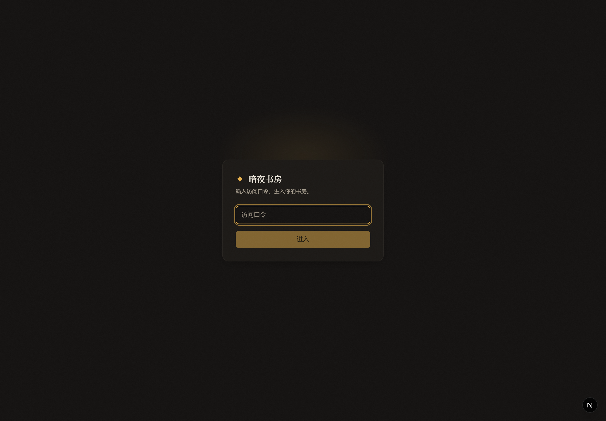

**图 1｜登录页**：全站唯一公开入口，只输入一个访问口令（`AUTH_PASSCODE`），无注册、无第三方登录，体现「单用户自托管」定位。

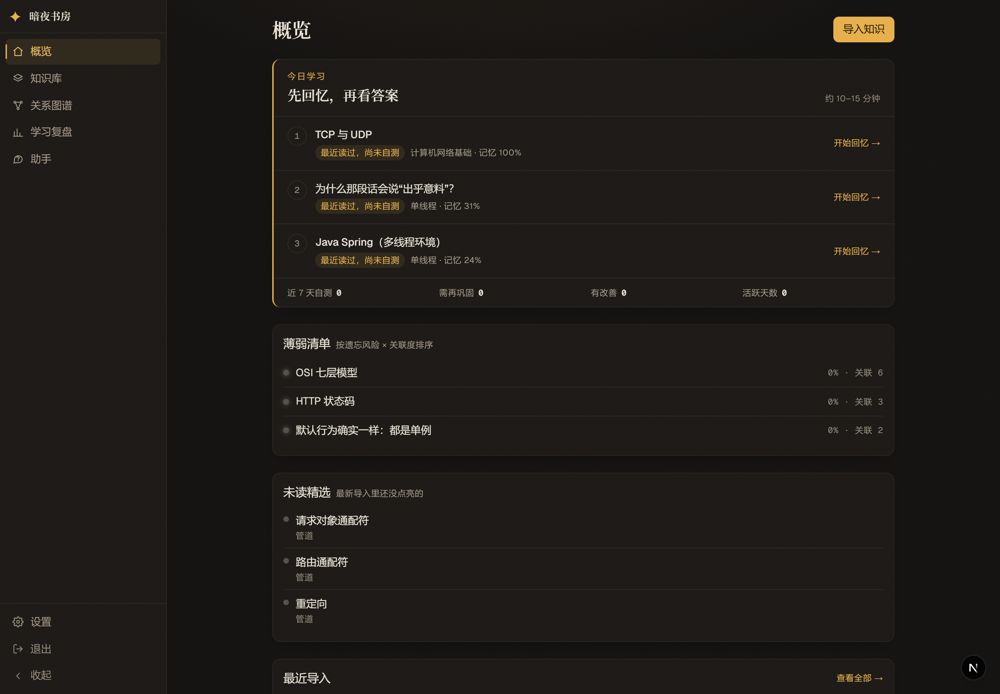

**图 2｜概览首页**：产品主入口。顶部「今日学习」给出 3 条可解释推荐（如「TCP 与 UDP · 最近读过，尚未自测 · 记忆 100%」），下方是「薄弱清单」「未读精选」「最近导入」，右侧主按钮「导入知识」。

### 10.2 学习闭环（最能体现产品价值）

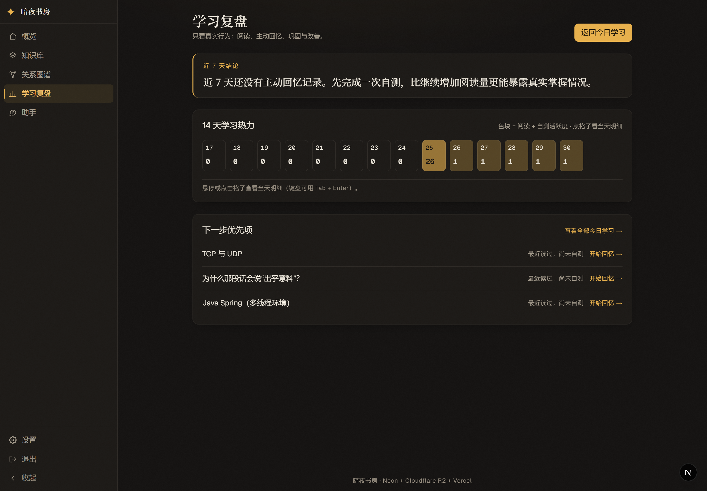

**图 3｜学习复盘 `/progress`**：7 天结论文案 + 14 天学习热力（含阅读与自测活跃度）+「下一步优先项」，把「读了什么、记住了多少、下一步做什么」压在一屏。

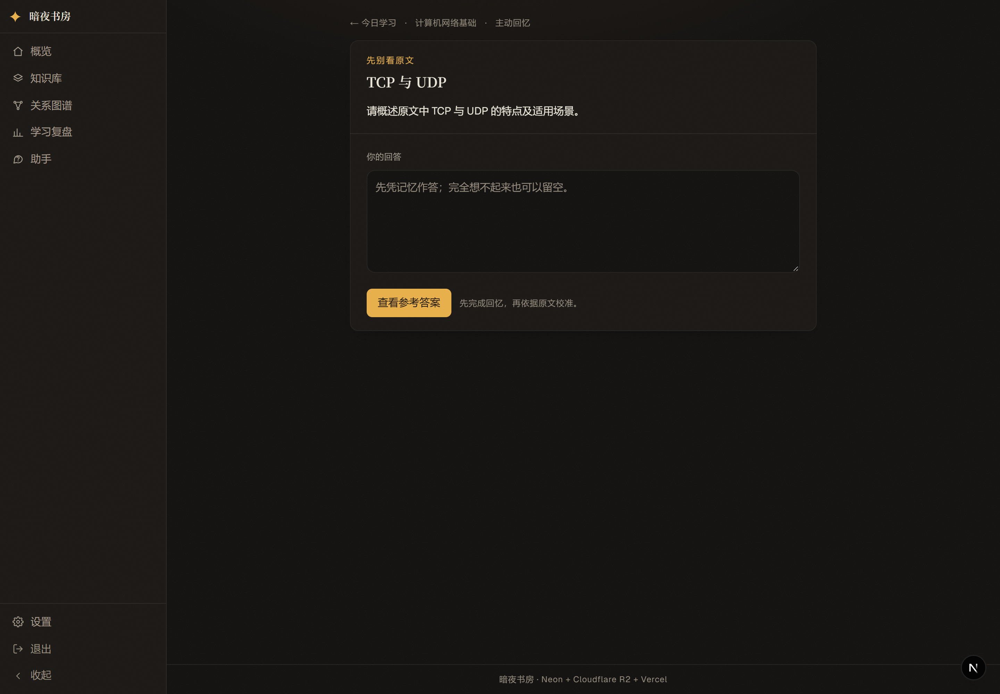

**图 4｜主动回忆 `/study/[segmentId]`（先作答）**：进入后先给问题「请简述原文中 TCP 与 UDP 的特点及适用场景」，只给原文标题与作答框，**先回忆再看答案**。

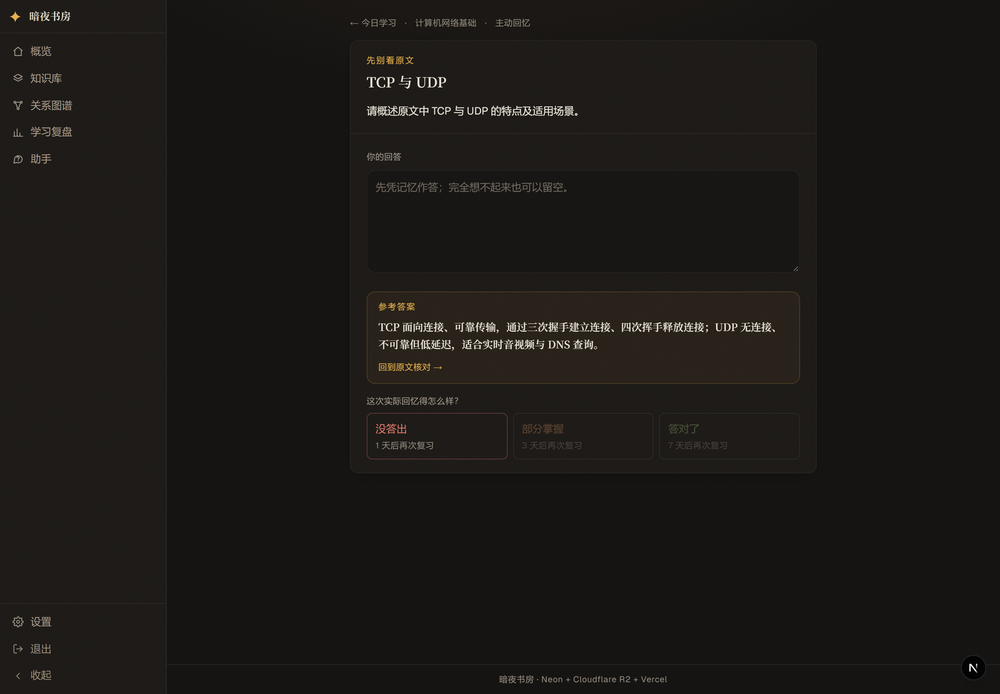

**图 5｜主动回忆（揭晓参考答案）**：点击「查看参考答案」后展示原文依据的参考答案，并给出三档真实自评（没答出 / 部分掌握 / 答对了），分别对应 1/3/7 天后复习——这是「看过 ≠ 会了」的具体落点。

### 10.3 关系图谱

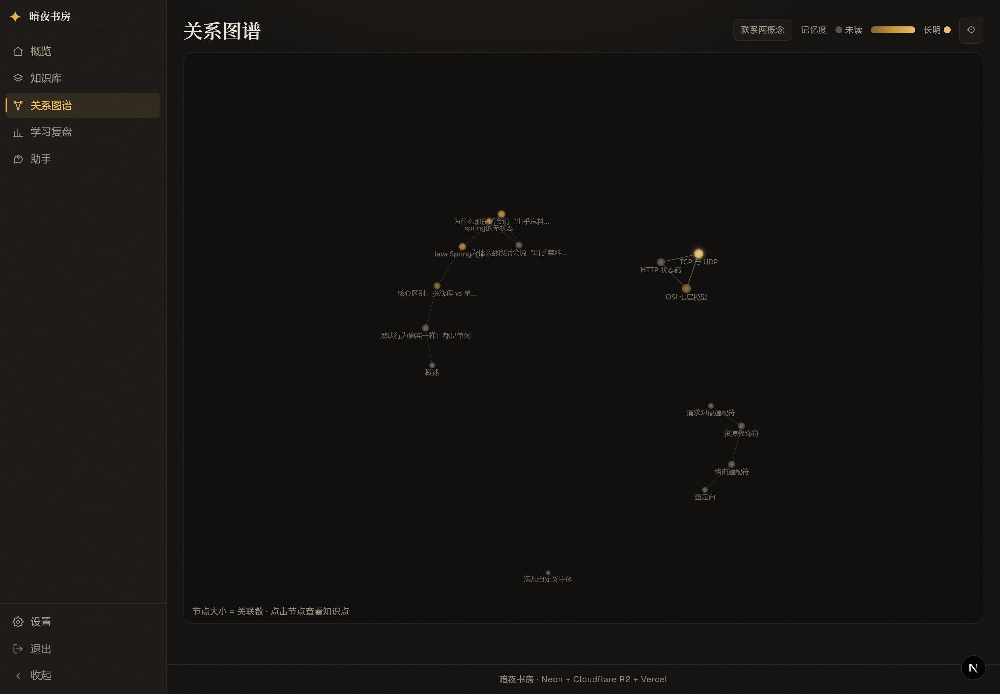

**图 6｜关系图谱（真实数据）**：节点=知识点，大小=关联数，亮度=记忆度（暗灰=未读，越亮记得越牢）；顶部可切换「联系两概念」双选、记忆度过滤与关联类型过滤。

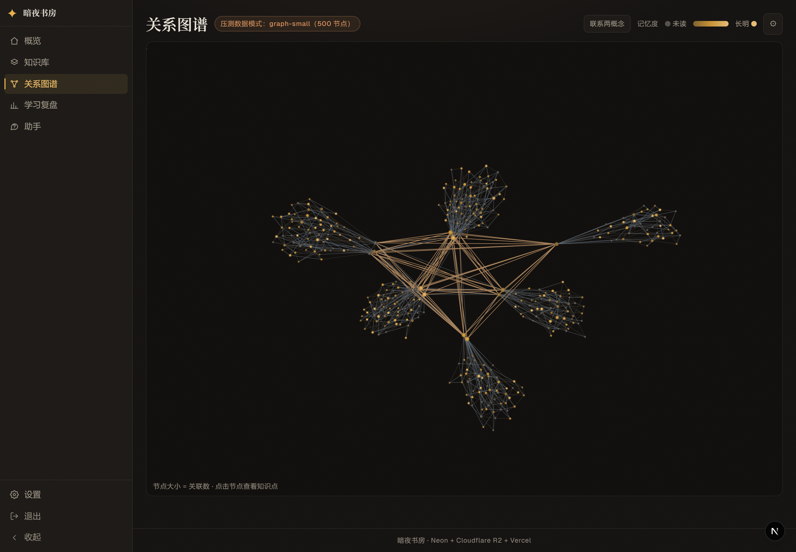

**图 7｜图谱压测形态 `?fixture=graph-small`（500 节点）**：页面顶部标注「压测数据模式：graph-small（500 节点）」，用于在不碰真实库的情况下验证渲染性能。

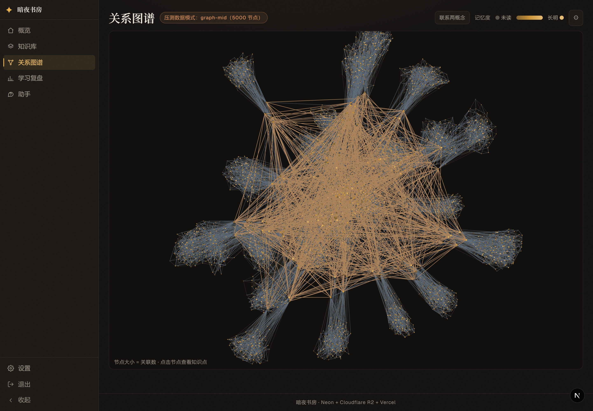

**图 8｜图谱压测形态 `?fixture=graph-mid`（5000 节点）**：同一路由换成社区结构大数据集，观察布局收敛与交互流畅度。

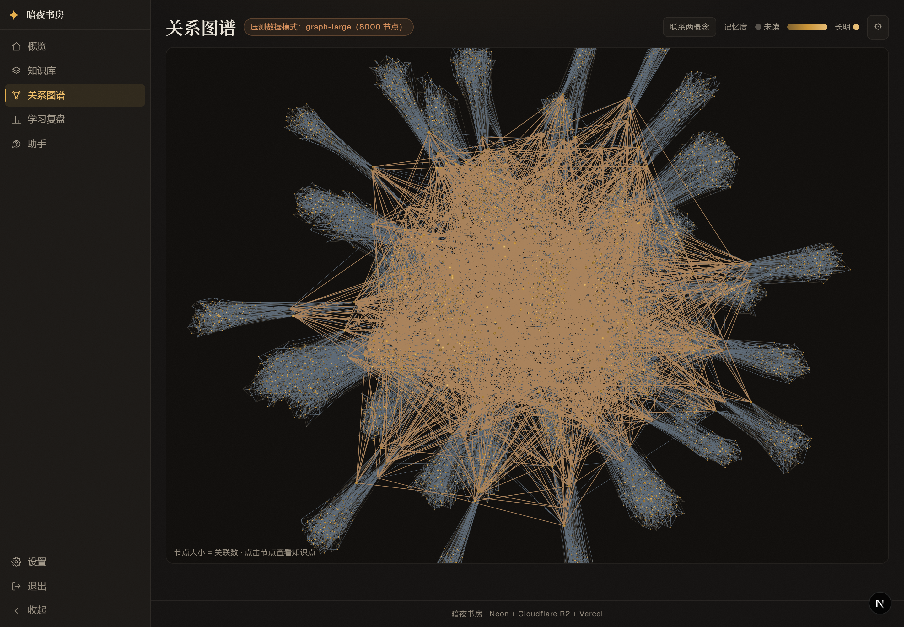

**图 9｜图谱压测形态 `?fixture=graph-large`（8000 节点）**：当前生成器最大档；布局已收敛但仍可交互，是「个人库规模上限」的直观参照（方案中讨论的 20k 目标尚未生成）。

### 10.4 内容组织与阅读

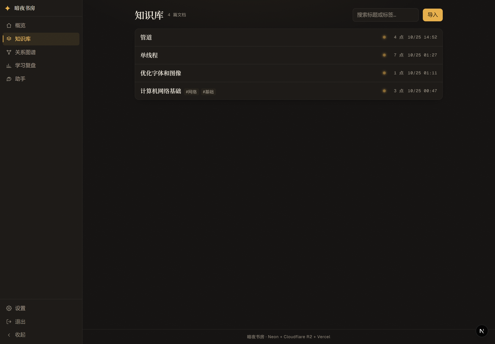

**图 10｜知识库列表 `/notes`**：每篇文档显示标题、标签、知识点数量、创建时间与平均记忆度灯点；顶部有搜索与「导入」入口。

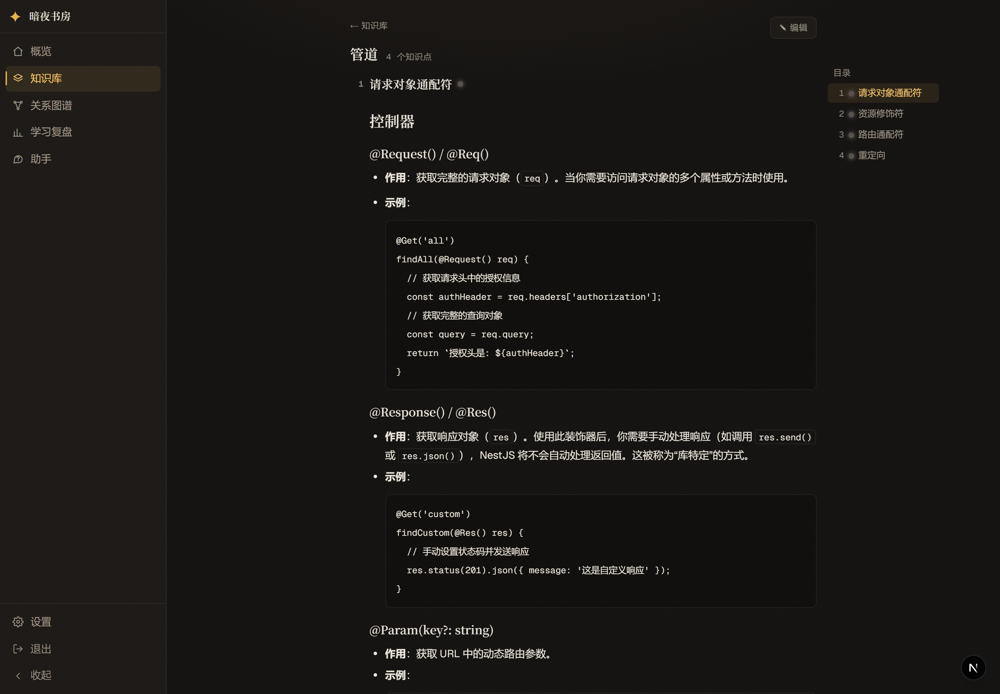

**图 11｜文档详情 `/notes/[id]`（连续阅读）**：右侧目录、段级记忆灯点、正文按段连续阅读并渲染代码块；停留时长会在离开页面时上报（`sendBeacon`），驱动记忆曲线。

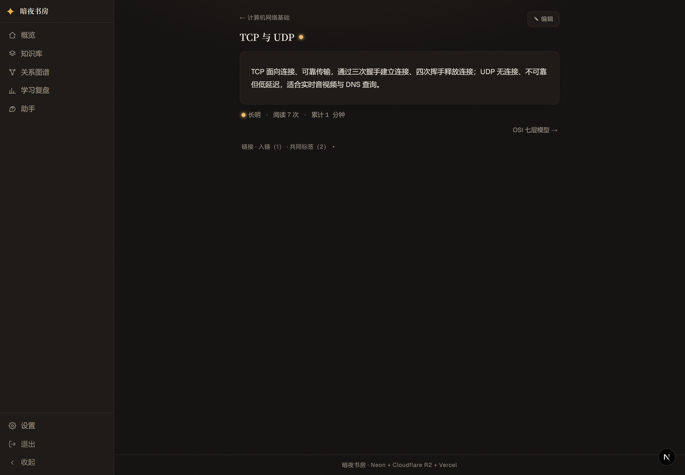

**图 12｜知识点详情 `/segments/[id]`**：单段的阅读视图，展示记忆档位（长明）、阅读次数、累计时长、出入链（1）、共同标签（2），并可直接进入编辑与关联跳转。

### 10.5 助手、导入与设置

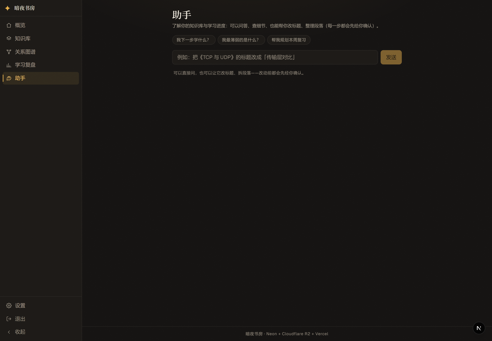

**图 13｜助手 `/ask`（空态）**：说明助手能力边界（问答、查细节、改标题、整理段落，改动前先确认），提供 3 个预设问题与示例指令，体现「Agent + 改动确认卡」的交互范式。

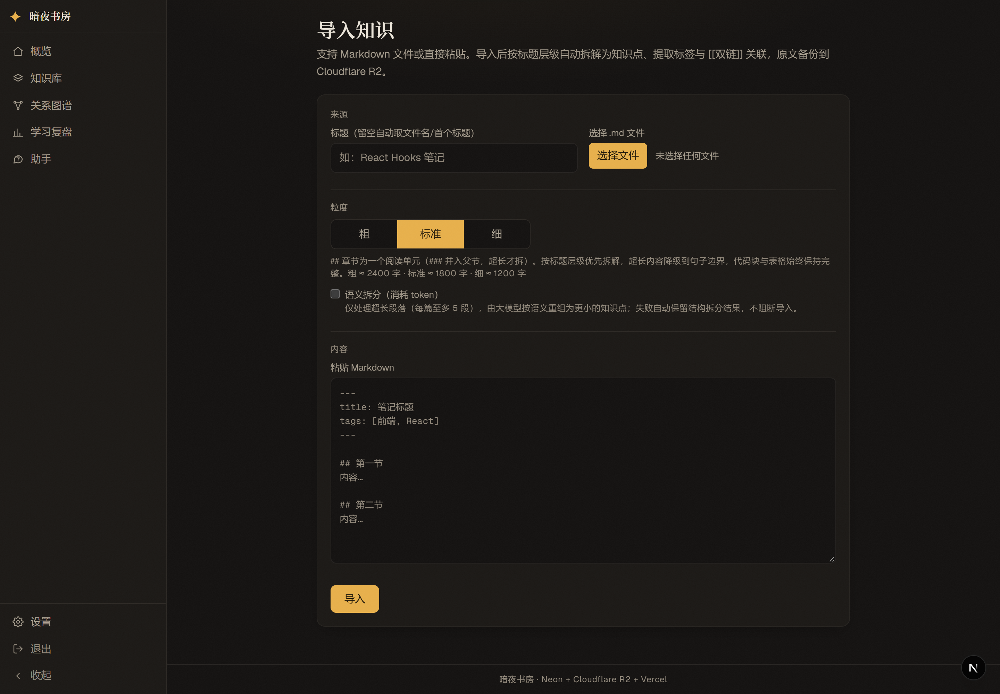

**图 14｜导入 `/import`**：支持「文件 / 粘贴 Markdown」，可选粒度三档（粗 / 标准 / 细）与「语义拆分（消耗 token）」开关；下方说明按标题层级自动拆解、提取标签与双链、原文备份 R2。

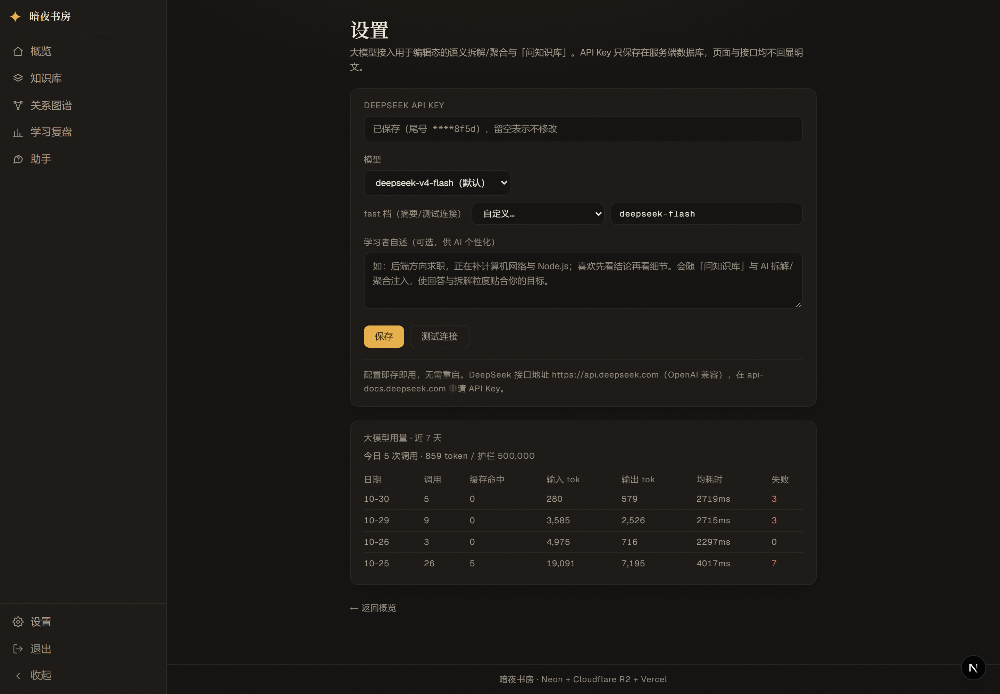

**图 15｜设置 `/settings`**：DeepSeek API Key（只显示尾号，留空不修改）、模型与 fast 档、学习者自述（供 AI 个性化），下方是近 7 天调用用量（调用数、缓存命中、输入/输出 token、均耗时、失败数）。

---

## 11. 未获取的内容（诚实标注）

| 项 | 状态 | 原因 |
|---|---|---|
| 助手真实对话中的流式回答、工具检索过程、改动确认卡 | **未获取** | 本轮只采集空态；完整对话需触发真实 LLM 多轮调用与交互，未纳入截图范围（不是页面打不开） |
| 编辑态的 AI 拆解预览 / 聚合预览 / 段编辑卡 | **未获取** | 需先在页面内选中段并触发 preview 才能出现，本轮未做交互录制 |
| 移动端 / 375px 窄屏形态 | **未获取** | 本轮按 1440×1000 桌面视口采集 |
| 文档划线 / 笔记高亮的视觉态 | **未获取** | 需手动选中文本产生标注 |
| 生产环境的数据与页面 | **未获取** | 截图来自本地 `.env.local` 指向的 Neon 库（4 文档 / 15 知识点），与生产可能不同 |
| 20k 节点图谱 | **未获取** | 生成器当前最大档为 `graph-large`（8000 节点），方案里的 20k 目标数据未生成 |
| R2 原文备份链路 | **未获取（未配置）** | 本地 `.env.local` 无 `R2_*` 变量，导入照常可用，但不写对象存储 |

所有截图均为真实运行界面，未使用占位图或绘制图。

---

## 12. 给外部 AI 的最小使用建议

- 想理解产品：先看 §1 + 图 2 / 图 3 / 图 4 / 图 6。
- 想复现项目：按 §3 命令 + §2.2 环境变量；注意 `npm run build` 需要 `DATABASE_URL`。
- 想改代码：先读 §5.1 路由表定位入口，再读 §6.2 表结构与 §7 铁律；涉及 Next 16 API 时先查 `node_modules/next/dist/docs/`。
- 想评估进度：直接读 §9 并跳转 `docs/未完成任务清单.md`，不要以本文摘要替代原文细节。
