# 项目全景说明（Project Panorama）

> **用途**：交付给外部网页版 LLM / agent 的单文件全景资料。读者不打开仓库，只读本文即可理解：项目是什么、怎么跑、整体结构如何、主要模块与关键入口在哪、各文档之间是什么关系。
> **本文档在文档体系中的位置**：[README.md](./README.md) 是目录索引，本文是「面向外部协作者的全景叙事 + 文档关系总图」；[handoff/project-dossier.md](./handoff/project-dossier.md) 是交接包的源码级主文档，三者分工见 §11.1。

| 项目 | 内容 |
|---|---|
| 文档版本 | v2.0（2026-11-04 重写：更新基线、纳入全貌截图、补齐文档关系与整理记录） |
| 编制/更新日期 | 2026-11-04 |
| 代码基线 | 工作区 `D:\20-Work\knowledgeBase`，Git HEAD `c4c9591`；**工作区含大量未提交改动**（2026-11-02 ~ 11-04 的前端修复批次），本文按**当前磁盘状态**核实，不等同于 HEAD |
| 事实来源 | 当轮核实：`package.json`、`.env.example`、`src/` 文件清单与关键实现、`docs/` 全部文件与相对链接扫描、已有截图文件；未核实的内容显式标注 |
| 维护约定 | 新增/删除页面或路由、表字段、依赖版本、界面改版、文档目录变动时，必须回写本文对应章节（§2.1、§4、§5.1、§6.2、§10、§11）；详见 [README.md](./README.md) §4 |

---

## 1. 项目定位与目标用户

### 1.1 一句话用途

**个人知识库**：把 Markdown 笔记导入后自动拆成「知识点」并建立双链关联，以「记忆程度」为轴组织阅读、主动回忆、复盘与关系图谱的**单用户 Web 应用**。目标不是做通用笔记软件，而是回答「现在该读什么、哪些快忘了、学过的是否真的会了」。

| 项 | 内容 |
|---|---|
| 名称 / 版本 | `knowledge-base` v0.1.0（private，`package.json`） |
| 形态 | 单用户 Web 应用，单口令登录，无注册、无多租户、无公开分享 |
| 目标用户 | 单个学习者（作者本人）；自托管 / 个人部署 |
| 部署 | Vercel Hobby（个人非商业）；进程内缓存按单实例假设设计 |
| 工作语言 | 界面、代码注释、文档均为简体中文 |
| 本地启动 | `npm run dev` → `http://localhost:3000`（需 `.env.local` 中 `DATABASE_URL`、`AUTH_PASSCODE`） |

### 1.2 核心使用闭环

```
导入 Markdown  →  自动拆段 / 提标签 / 建双链  →  首页「今日学习」推荐
      ↑                                              ↓
  图谱看结构  ←  复盘看趋势  ←  主动回忆自测  ←  阅读知识点（停留时长驱动记忆度）
```

- **阅读即学习**：打开知识点计一次查看，停留达到阈值后推进稳定度；记忆度按 `exp(-Δt/S)` 读取时现算，不落库。
- **忘得快的地方在图谱里变暗**：节点亮度 = 记忆度，档位为 未读 / 微光 / 明亮 / 长明。
- **看过 ≠ 会了**：主动回忆先作答、再揭晓参考答案，三档自评分别对应 1 / 3 / 7 天后复习。

### 1.3 明确非目标

| 非目标 | 说明 |
|---|---|
| 多用户 / 注册 / 协作 / 分享 | 单口令会话，无权限体系 |
| 移动原生 App | 只做响应式 Web（含 PWA manifest 与安全区适配） |
| 富文本 / 图片为主的笔记 | 当前只支持 Markdown 纯文本导入 |
| 通用聊天机器人 | 助手对话只服务本库内容与本库学习进度 |
| 向量检索 | 当前检索为关键词 + 片段抽取，无向量库、无 tiktoken |

---

## 2. 技术栈与关键依赖

### 2.1 运行时与框架（以 `package.json` 实值为准）

| 层 | 技术 | 版本 | 用途 / 备注 |
|---|---|---|---|
| 框架 | `next` | `16.4.3` | App Router；`next.config.ts` 开启 `cacheComponents: true`、`partialPrefetching: true` |
| UI | `react` / `react-dom` | `19.3.0` | Server Components + 客户端交互组件 |
| 样式 | `tailwindcss` + `@tailwindcss/postcss` | `^4` / `^4.3.3` | CSS-first，无 `tailwind.config` |
| 语言 | `typescript` | `^5` | `npm run typecheck` = `tsc --noEmit` |
| 数据库 | `@neondatabase/serverless` / `drizzle-orm` | `^1.2.0` / `^0.45.4` | HTTP 驱动 + `db.batch` 原子提交 |
| 迁移 | `drizzle-kit` | `^0.31.11` | `src/db/migrations/` 下 8 个 SQL |
| 对象存储 | `@aws-sdk/client-s3` | `^3.1156.0` | S3 兼容接 Cloudflare R2，列入 `serverExternalPackages` |
| 图谱 | `react-force-graph-2d` | `^1.29.2` | Canvas 力导向图 |
| Markdown | `react-markdown` / `remark-gfm` / `js-yaml` | `^10.1.0` / `^4.0.1` / `^5.5.0` | 阅读渲染与 frontmatter |
| 测试 | `vitest` / `@playwright/test` | `^5.0.5` / `^1.64.1` | 60 个测试文件；E2E 在 `e2e/auth-graph.spec.ts` |
| Lint | `eslint` / `eslint-config-next` | `^9` / `16.4.3` | `npm run lint` |

本机 Node 实测 `v22.22.2`。

> ⚠️ **Next.js 16 与常见训练数据中的版本存在破坏性差异**。仓库根 `AGENTS.md` 要求：改代码前先读 `node_modules/next/dist/docs/` 对应指南。本项目的 `proxy.ts`（等价旧 middleware）、`LayoutProps<"/">` 等写法均来自该版本约定。

### 2.2 环境变量（以 `.env.example` 实值为准）

| 变量 | 必填 | 说明 |
|---|---|---|
| `DATABASE_URL` | 是 | Neon Pooled 连接串 |
| `AUTH_PASSCODE` | 是 | 登录口令；未配置时全站不可用 |
| `SETTINGS_ENCRYPTION_KEY` | 否 | LLM Key 加密主密钥；不填则由 `AUTH_PASSCODE` 派生（**改口令会使旧密文失效**） |
| `R2_ACCOUNT_ID` / `R2_ACCESS_KEY_ID` / `R2_SECRET_ACCESS_KEY` / `R2_BUCKET` | 否 | 不配则导入不备份原文，功能不受影响 |
| `LLM_API_KEY` / `LLM_MODEL`、`DEEPSEEK_API_KEY` / `DEEPSEEK_MODEL` | 否 | 应用内「设置」页配置的回退；推荐用设置页（即存即用、无需重启） |

本地 `.env.local` 的值不写入任何文档；交接包同样只出现变量名。

### 2.3 运行时架构

```text
浏览器（Cookie 会话，HttpOnly）
   │
   ▼
src/proxy.ts                 全站登录门：/login、/api/auth 放行；
   │                        未登录页面 → /login?next=…；API → 401
   ▼
App Router 页面（RSC + 客户端组件）  ⇄  /api/* Route Handlers
   │                                        │
   ▼                                        ▼
src/components/*（展示与交互）      src/lib/*（业务层）
                                          │
                        ┌─────────────────┼──────────────────┐
                        ▼                 ▼                  ▼
                  Neon Postgres      Cloudflare R2      DeepSeek API
                  （唯一持久源）     （原文备份，可选）  （OpenAI 兼容，可选）
```

要点：

- 业务逻辑集中在 `src/lib/*`，路由只做鉴权、校验与编排。
- 数据库连接惰性初始化（`src/db/index.ts` Proxy），使 `next build` 导入路由模块时不立即连接。
- 多表写入走 Neon HTTP batch（`src/lib/db-batch.ts`），失败整体回滚。
- 读路径韧性：`src/lib/db-retry.ts` 瞬时故障重试 → `src/lib/db-read.ts` 回退陈旧快照（响应头 `X-Cache: STALE`）→ 完全不可用返回 503 + 页面重试入口。
- 两层缓存：进程内 TTL（`src/lib/cache.ts`）+ 数据库 LLM 输出缓存（`llm_cache` 表）。
- 会话过期的统一恢复：`src/lib/client.ts` 识别 401 后跳转登录页并带回原路径（登录页与认证接口除外）；2026-11 修复批次已把该能力从各页面收敛到请求层。

---

## 3. 安装与运行

```bash
npm install
copy .env.example .env.local     # Windows；Linux/macOS 用 cp；填 DATABASE_URL、AUTH_PASSCODE
npm run db:migrate               # 顺序执行 src/db/migrations/*.sql
npm run db:migrate:check         # 只读检查待执行迁移（--dry-run）
npm run dev                      # http://localhost:3000
```

### 3.1 脚本全表（`package.json` 实值）

| 命令 | 实际执行 | 用途 |
|---|---|---|
| `npm run dev` | `next dev` | 开发服务器（Turbopack） |
| `npm run build` | `next build` | 生产构建（需 `DATABASE_URL`） |
| `npm run start` | `next start` | 启动生产构建 |
| `npm run lint` / `npm run typecheck` | `eslint` / `tsc --noEmit` | 静态检查 |
| `npm run test` / `npm run test:watch` | `vitest run` / `vitest` | 单元与组件测试 |
| `npm run test:e2e` | `node scripts/run-e2e.mjs` | Playwright 回归（自动起 3100 端口 dev server） |
| `npm run perf:graph` | `node scripts/measure-graph.mjs` | 图谱性能测量 |
| `npm run db:generate` / `db:push` / `db:studio` | `drizzle-kit …` | 迁移生成 / 推 schema / 数据浏览 |
| `npm run db:migrate` / `db:migrate:check` | `node --env-file=.env.local scripts/apply-migrations.mjs [--dry-run]` | 迁移执行 / 检查 |

`scripts/` 另有 `gen-graph-data.mjs`（生成 `?fixture=` 三档压测数据）、`mock-llm.mjs`（测试用假模型服务）、`perf-seed.mjs`（压测灌数）。

### 3.2 部署边界

1. Vercel 导入仓库，配置 `DATABASE_URL`、`AUTH_PASSCODE`（可选 `SETTINGS_ENCRYPTION_KEY`、`R2_*`）；
2. 首次部署后手工执行一次 `npm run db:migrate`；
3. 已知平台限制：请求体上限约 4.5MB；多实例下进程内缓存失效为 best-effort；`public/fixtures/*.json` 被 `.gitignore` 忽略，新环境需重新生成。

---

## 4. 整体结构与主要模块

### 4.1 仓库目录树（2026-11-04 整理后）

```text
knowledge-base/
├── AGENTS.md                  # 仓库规则：Next 16 文档先行 + 提示词生成规范
├── README.md                  # 使用说明、已知限制、Roadmap
├── package.json / .env.example / next.config.ts / tsconfig.json
├── public/                    # 图标、manifest（PWA）与 fixtures/ 压测数据
├── scripts/                   # 6 个 mjs：迁移、E2E、性能、fixture、mock、灌数
├── e2e/auth-graph.spec.ts     # Playwright 回归
├── src/
│   ├── proxy.ts               # 认证网关（关键入口）
│   ├── app/                   # 11 个页面 + 30 个 API Route Handler + layout/globals/manifest
│   ├── components/            # 23 个 tsx：12 个通用组件 + 11 个 graph/ 组件
│   ├── lib/                   # 55 个 ts 业务模块 + __tests__/（60 个测试文件）
│   ├── db/                    # index.ts / schema.ts（9 张表）/ migrations（8 个 SQL）
│   └── types/
├── docs/                      # 文档体系，见 §4.3 与 §11.1
├── artifacts/                 # 验收日志、报告与截图（非文档体系，供追溯）
└── test-results/              # Playwright 运行产物
```

### 4.2 主要模块

| 模块 | 位置 | 职责 |
|---|---|---|
| 页面与路由 | `src/app/` | 11 个 `page.tsx`（见 §5.1）+ `layout.tsx` 挂全站外壳 + `globals.css` |
| API | `src/app/api/` | 30 个 `route.ts`（见 §5.3），覆盖认证、笔记、知识点、标注、图谱、学习、AI、设置、用量 |
| 全站外壳 | `src/components/AppShell.tsx` | 非沉浸页的导航（桌面左竖栏 / 移动底部条）、页脚、安全区、全站 `Ctrl/Cmd+K` 快速检索 |
| 图谱 | `src/components/graph/` | `KnowledgeUniverse.tsx` 编排；`GraphCanvas` 渲染；`GraphSearch`、`GraphDetailPanel`、`GraphNavigation`、`GraphThemePanel`、`GraphMinimap` 等 |
| 阅读与编辑 | `src/components/SectionEditor.tsx`、`SegmentEditCard.tsx`、`WikiMarkdown.tsx` | 段编辑卡、知识点编辑卡、Markdown 渲染 |
| 反馈与状态 | `ErrorState.tsx`、`InlineFeedback.tsx`、`Skeleton.tsx`、`AiOverlay.tsx` | 统一错误/空/加载态；AI 预览浮层（含焦点陷阱） |
| 概览与学习 | `DashboardPanel.tsx`、`TodayLearningPanel.tsx`、`MemoryBadge.tsx` | 首页行动面板、今日学习、记忆档位灯点 |
| 业务层 | `src/lib/` | 拆分（`splitter`）、双链（`links`）、记忆（`memory`）、标注（`annotations`）、检索（`rag`）、LLM（`llm`）、Agent 工具（`agent-tools`）、学习计划（`learning-plan`）、助手对话（`ai/ask-conversation`）、韧性（`db-retry`/`db-read`/`cache`）等 |
| 表现层基础 | `src/lib/ui/` | 对比度、几何、主题、焦点陷阱 |
| 图谱逻辑 | `src/lib/graph/` | 布局、搜索索引、聚焦与最短路径、主题偏好、详情缓存、学习地图、筛选空态、邻居预览 |
| 数据层 | `src/db/` | Drizzle schema（9 张表）+ 迁移 |

### 4.3 文档体系与相互关系（速览）

```text
                    docs/README.md（唯一索引 / 命名与维护规范）
                              │
      ┌──────────────┬───────┴────────┬──────────────┬─────────────┐
      ▼              ▼                ▼              ▼             ▼
  操作类文档      产品与台账        项目全景说明    plans/        handoff/
  快速开始.md     spec.md          （本文）       专项计划      交接包
  配置说明.md     未完成任务清单   外部 LLM 全景   + 11-03 审计  dossier/screenshots
  功能说明.md                                     + evidence    /index.html
  常见问题排查.md                                               /cleanup-report
                                                      │
  前端缺陷清单与修复方案.md（11-02 历史台账）        └──引用──▶ archive/（历史快照）
                                                                 ▲
                                            plans/knowledge-universe-tasks.md、
                                            systematic-iteration-plan.md、
                                            handoff/project-dossier.md 引用其中 3 份
```

完整文档地图、依赖链、删除与保留清单见 **§11**。

---

## 5. 关键入口

### 5.1 页面路由表（11 个 `page.tsx`）

| 路由 | 入口文件 | 作用 |
|---|---|---|
| `/login` | `src/app/login/page.tsx` | 口令登录（唯一公开页） |
| `/` | `src/app/page.tsx` → `DashboardPanel.tsx` | 概览：今日学习、薄弱清单、未读精选、最近导入 |
| `/notes` | `src/app/notes/page.tsx` | 文档列表（搜索、平均记忆度、段数） |
| `/notes/[id]` | `src/app/notes/[id]/page.tsx` | 文档连续阅读：目录、划线、笔记、编辑模式 |
| `/segments/[id]` | `src/app/segments/[id]/page.tsx` | 知识点详情：正文、记忆度、关联、编辑、开始复习 |
| `/study/[segmentId]` | `src/app/study/[segmentId]/page.tsx` | 主动回忆：作答 → 揭晓 → 三档自评 |
| `/graph` | `src/app/graph/page.tsx` | 关系图谱（支持 `?fixture=graph-small\|graph-mid\|graph-large`） |
| `/progress` | `src/app/progress/page.tsx` | 学习复盘：7 天结论、14 天热力、下一步优先项 |
| `/ask` | `src/app/ask/page.tsx` | AI 助手：多轮对话、上下文 chips、改动确认卡 |
| `/import` | `src/app/import/page.tsx` | 导入：文件 / 粘贴、粒度三档、语义拆分开关 |
| `/settings` | `src/app/settings/page.tsx` | LLM Key / 模型 / fast 档 / 学习者自述 / 用量 |

全站布局：`src/app/layout.tsx` → `AppShell`；`/graph` 为沉浸页，导航由 `KnowledgeUniverse` 自行渲染。`src/app/manifest.ts` 提供 PWA manifest。

### 5.2 核心交互流程

| 流程 | 入口 | 关键路径 |
|---|---|---|
| 导入 | `POST /api/notes` | `splitter.splitMarkdown` 按标题拆段 → 可选 `semanticSplit` → 写 `documents`/`segments` → 重建 wiki/tag/doc 边 → 可选 R2 原文备份 |
| 阅读即学习 | `POST /api/segments/[id]/view` | 打开 ping 记 `viewCount`；停留达阈值写 `reading_events` 并推进 `stability`；记忆度读取时现算 |
| 今日学习与自测 | `GET /api/learning/today` → `POST /api/learning/question` → `POST /api/learning/reviews` | 确定性推荐排序 → 生成问题 → `submissionId` 幂等提交自评并算 `nextReviewAt` |
| 图谱 | `GET /api/graph` 或 `/fixtures/<name>.json` | 节点 = 知识点；单击详情、双击阅读、Ctrl/Cmd+K 搜索、双选最短路径、学习地图标记、主题偏好持久化 |
| 助手 | `POST /api/ai/ask`（SSE） | 常驻知识库概览 + 学习者画像 → 工具 `search_knowledge`/`read_segment`/`propose_actions` → 改动**只提议不写库**，由前端确认卡走 apply |
| AI 改写 | `*-preview` → `*-apply` | 拆解 / 聚合两步确认；预览端点无业务写操作 |
| 认证 | `POST /api/auth/login` / `logout` | 口令校验 + HttpOnly Cookie；`src/proxy.ts` 全站拦截；401 由 `src/lib/client.ts` 统一跳登录 |

### 5.3 API 端点清单（30 个 `route.ts`）

| 分组 | 端点 |
|---|---|
| 认证 | `/api/auth/login`、`/api/auth/logout` |
| 统计与设置 | `/api/stats`、`/api/settings`、`/api/ai/config`、`/api/ai/test`、`/api/ai/usage` |
| 文档 | `/api/notes`、`/api/notes/[id]`、`/api/notes/[id]/segments`、`/api/notes/[id]/annotations` |
| 知识点 | `/api/segments/[id]`、`/api/segments/[id]/move`、`/api/segments/[id]/view`、`/api/segments/[id]/summary`、`/api/segments/[id]/annotations`、`/api/annotations/[id]` |
| 图谱 | `/api/graph` |
| 学习 | `/api/learning/today`、`/api/learning/weekly`、`/api/learning/question`、`/api/learning/reviews`、`/api/learner-profile` |
| AI | `/api/ai/ask`、`/api/ai/explain`、`/api/ai/connect`、`/api/ai/split-preview`、`/api/ai/split-apply`、`/api/ai/aggregate-preview`、`/api/ai/aggregate-apply` |

---

## 6. 数据来源与数据模型

### 6.1 数据来源

| 来源 | 说明 |
|---|---|
| Neon Postgres | 唯一持久业务数据源，9 张表；本地实例为个人样例数据 |
| 图谱 fixture | `public/fixtures/graph-small|mid|large.json`，由 `scripts/gen-graph-data.mjs` 生成，被 `.gitignore` 忽略，仅 `/graph?fixture=` 使用 |
| DeepSeek API | `https://api.deepseek.com`（OpenAI 兼容）；Key 存 `app_settings`（AES-GCM）或环境变量回退 |
| Cloudflare R2 | 可选，仅备份导入原文 |
| 进程内缓存 | `src/lib/cache.ts` TTL 缓存 + 陈旧快照降级 |

### 6.2 数据模型（`src/db/schema.ts`，9 张表）

| 表 | 关键字段 |
|---|---|
| `documents` | `title`、`source`(paste/file)、`filename?`、`storageKey?`、`tags[]`、`segmentCount`、`createdAt` |
| `segments` | `documentId`(FK 级联)、`title`、`content`、`headingPath`、`orderIndex`、`tags[]`、`viewCount`、`firstViewedAt?`、`lastViewedAt?`、`stability`、`readingMs`、`summary?` |
| `links` | `fromId`/`toId`、`kind`(wiki/tag/doc)、`weight`；唯一 `(from_id,to_id,kind)` |
| `annotations` | `segmentId`、`kind`(highlight/note)、`quote?`、`occurrence`、`prefix?`/`suffix?`、`note?`、`color` |
| `readingEvents` | `segmentId`、`startedAt`、`durationMs`（仅有效停留写入） |
| `recallReviews` | `submissionId`(幂等)、`segmentId`、`question`、`referenceAnswer`、`answer`、`result`、`sourceVersion`、`reviewedAt`、`nextReviewAt?` |
| `appSettings` | `key`(PK)、`value`(jsonb) |
| `llmCache` | `hash`(PK)、`kind`、`output`、`model`、`expiresAt?` |
| `llmCalls` | `kind`、`model`、`inTok`、`outTok`、`ms`、`cached`、`error?`、`createdAt`（只记用量，不记 prompt） |

所有主键 `uuid defaultRandom()`，时间戳 `timestamptz`；迁移文件 8 个，位于 `src/db/migrations/`。

### 6.3 关键接口返回字段

| 接口 | 结构 |
|---|---|
| `GET /api/stats` | `{ total, byTier, tierOrder, readToday, recentDocuments[], suggestion, weakTop3[], unreadTop3[] }` |
| `GET /api/notes` | `{ documents: [{ id, title, source, tags, segmentCount, createdAt, avgMemory }] }` |
| `GET /api/graph` | `{ nodes: [{ id, title, memory, viewCount, readingMs, documentTitle }], edges: [{ source, target, kind, weight }] }` |
| `GET /api/learning/today` | `{ items: [{ segmentId, title, documentId, documentTitle, memory, reasonCode, reason, latestResult, nextReviewAt, … }], metrics, generatedAt }` |
| `GET /api/learning/weekly` | `{ summary, current, previous, days[], priorityItems[] }` |
| `GET /api/ai/config` | `{ configured, model, fastModel, keyTail, learnerDeclaration }`（不回明文 Key） |
| `GET /api/ai/usage` | `{ days: [{ day, calls, cachedHits, inTok, outTok, errors, avgMs }], today, previewHitRate }` |

> 字段以接口源码为准；上表为结构摘要，未逐字段穷举。

---

## 7. 约定与铁律

1. **零新增依赖优先**：新增依赖需先决策。
2. **LLM 输出永不直接写库**：一律 `preview` → 用户确认 → `apply`；助手 `propose_actions` 只提议。
3. **隐私最小化**：`llm_calls` 不记 prompt；设置页不回 API Key 明文（只回 `keyTail`）。
4. **记忆度读取时现算、不落库**：落库只有 `stability`、`readingMs`、`reading_events`。
5. **单用户、Key 只在服务端**：无注册、无多租户。
6. **写操作原子性**：导入 / 段编辑移动删除 / AI 拆解聚合均用 Neon batch 事务。
7. **文案与视觉语言**：界面中文；记忆档位用灯光隐喻，不用数字直出。
8. **Next 16 版本纪律**：改代码前读 `node_modules/next/dist/docs/`。
9. **文档纪律**：代码与文档冲突时以代码为准并回写文档；相对链接、命名与格式规范见 [README.md](./README.md) §2–§3。

---

## 8. 已知坑点与限制

| # | 坑点 | 影响 / 规避 |
|---|---|---|
| 1 | `next build` 需要 `DATABASE_URL` | 构建机无变量会失败；惰性 Proxy 只解决「无查询不连接」 |
| 2 | 进程内缓存多实例不一致 | Vercel 多实例时写后失效只作用于当前实例；个人自用 best-effort |
| 3 | 流式超时 | 整流超时 + chunk 静默超时，长回答可能被掐断（`src/lib/llm.ts`、`stream-utils.ts`） |
| 4 | Key 加密依赖口令 | 未设 `SETTINGS_ENCRYPTION_KEY` 时由 `AUTH_PASSCODE` 派生，改口令使旧密文失效；设置页据 `keyState` 提示重新填写（`src/lib/app-settings.ts`） |
| 5 | 图谱全量返回 | `/api/graph` 无分页 / 聚合；大图需单独排期（见 `plans/frontend-quality-audit.md` FE-002） |
| 6 | fixture 不入库 | 新克隆需 `node scripts/gen-graph-data.mjs` 生成 |
| 7 | Vercel 请求体 4.5MB | 超大 md 需分次导入 |
| 8 | 单用户认证强度 | 会话令牌由口令派生，泄露面等价于口令本身（设计取舍） |
| 9 | 标注可能失效 | 段改写后三级锚点重定位仍可能丢锚点 |
| 10 | 数据库抖动 | 读路径重试 → 陈旧快照 → 503 + 重试按钮 |
| 11 | 只支持 Markdown 纯文本 | 图片 / PDF / DOCX 未实现 |
| 12 | 文档可能滞后于代码 | 工作区含未提交改动；以代码与最新审计报告为准 |

---

## 9. 未完成工作与近期批次摘要

| 资料 | 基线 | 状态 |
|---|---|---|
| [未完成任务清单.md](./未完成任务清单.md) | 2026-10-29 台账 + §8（2026-11-04） | 历史开放项与决策项（自测能力扩展、20k 图谱路线、ask 检索路线、资料输入扩展）；§8 为本轮迭代批次登记与状态追踪 |
| [执行版任务清单.md](./执行版任务清单.md) | 2026-11-04，**v1.2 · 冻结版** | 本轮「Knowledge Universe · 沉浸式知识宇宙」执行分发版：六阶段、28 个任务（T01–T25 / Q1–Q3），T07 为工程闸门；已落实 Git 改动保护、两层状态模型、数据来源映射表等 11 项校准；**T01 已启动（§9.3）**；**DEC-01**＝T09 青色外环 + T18 待复习标记，同一决策项待 T02 评审，当前不提前移除或确认；状态由协调 Agent 逐项回填到台账 §8 |
| [前端缺陷清单与修复方案.md](./前端缺陷清单与修复方案.md) | 2026-11-02，35 项缺陷 + T1–T10 | 2026-11-03/11-04 修复批次已按此实施主要项（对话渲染、401 统一跳转、图谱搜索收尾、段详情复习入口、全站 Ctrl+K、焦点陷阱等）；本文为历史台账，不代表当前仍存在这些缺陷 |
| [plans/frontend-quality-audit.md](./plans/frontend-quality-audit.md) | 2026-11-03，17 项缺陷 | 最新一次全站前端质量审计，含全页全貌截图证据；部分问题可能已在后续批次处理，需以代码复核 |
| [handoff/cleanup-report.md](./handoff/cleanup-report.md) | 2026-11-02 + §8 后续处置 | 文档与产物的清理记录 |

> **诚实标注**：本文未逐项复核上述台账中每一条的当前实现状态；如需准确进度，请按各文档标注的源码路径复核，或重新运行 `npm run test` / `npm run test:e2e`。

---

## 10. 全貌截图（已完成，本次纳入，未重新制作）

项目已有三套真实运行截图，互相补充、不重复制作：

| 批次 | 位置 | 特点 | 本文用途 |
|---|---|---|---|
| 11-03 全页全貌截图 | `plans/frontend-quality-audit-evidence/desktop-*-full.png`、`mobile-*-full.png` | 桌面 12 张 + 移动 10 张，**整页**截图（含页脚与底部导航），来自 11-03 全站前端质量审计 | **§10 主配图**，覆盖全站页面与各端形态 |
| 11-02 交接截图 | `handoff/screenshots/*.jpg`（17 张） | 语义化命名的 1600px 宽 JPEG，一一对应页面；映射表见 [handoff/README.md](./handoff/README.md) §3 | 交接包专用，可离线投喂 |
| 11-02 高清原图 | `images/*.png`（20 张） | 原图 1440×1000 @2x；2026-11-04 清理后保留现行批 16 张 + 登录页/压测补图 4 张 | 高分辨率原图与文档配图 |

### 10.1 桌面全貌（12 张，`*-full.png`）

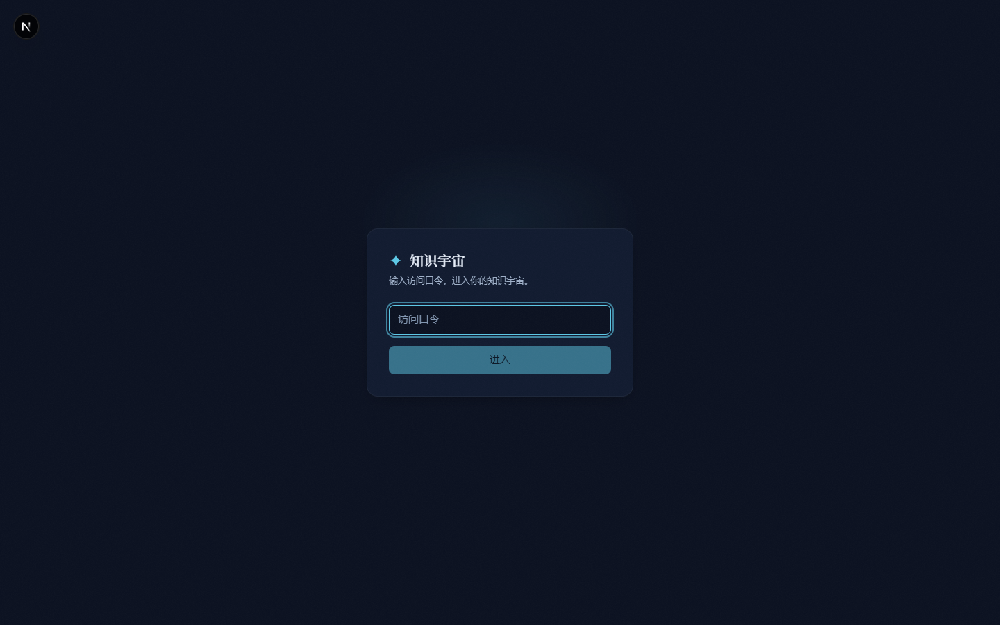

**图 1｜`/login`**：全站唯一公开入口，单口令、无注册。

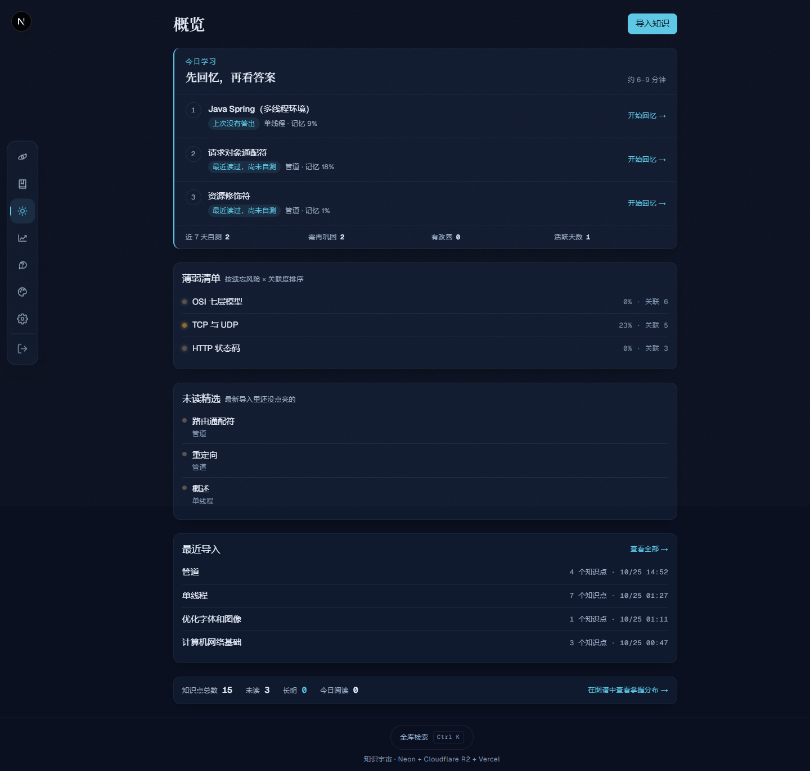

**图 2｜`/` 概览**：今日学习推荐、薄弱清单、未读精选、最近导入与降权统计带；右侧「导入知识」是唯一主按钮。

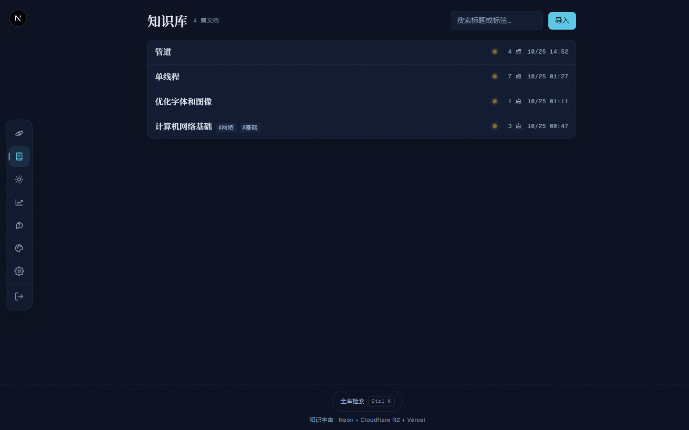

**图 3｜`/notes`**：文档列表、标签、知识点数、平均记忆度灯点，顶部搜索与导入入口。

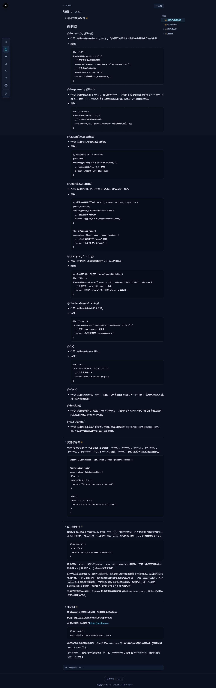

**图 4｜`/notes/[id]`**：连续阅读、目录、段级记忆灯点、划线与笔记入口。

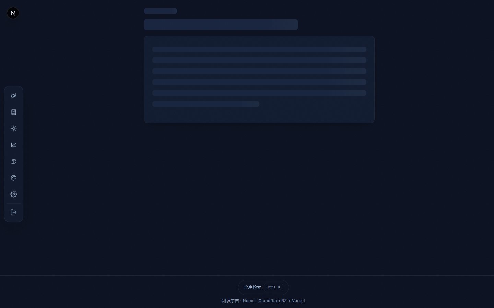

**图 5｜`/segments/[id]`**：单段正文、记忆档位、阅读次数与时长、出入链与共同标签、编辑与复习入口。

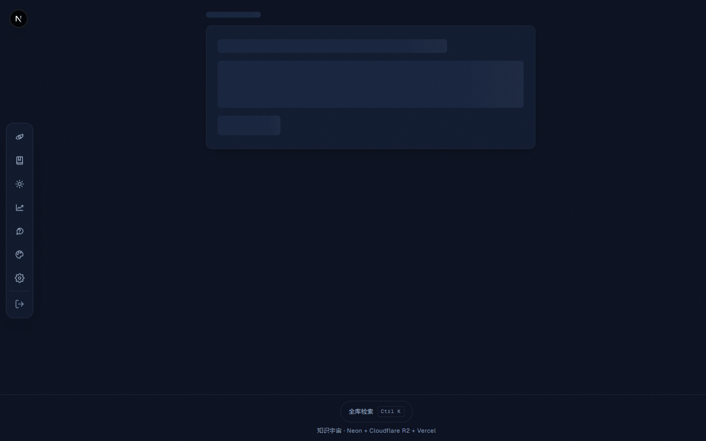

**图 6｜`/study/[segmentId]`**：先作答、再揭晓参考答案、三档自评。

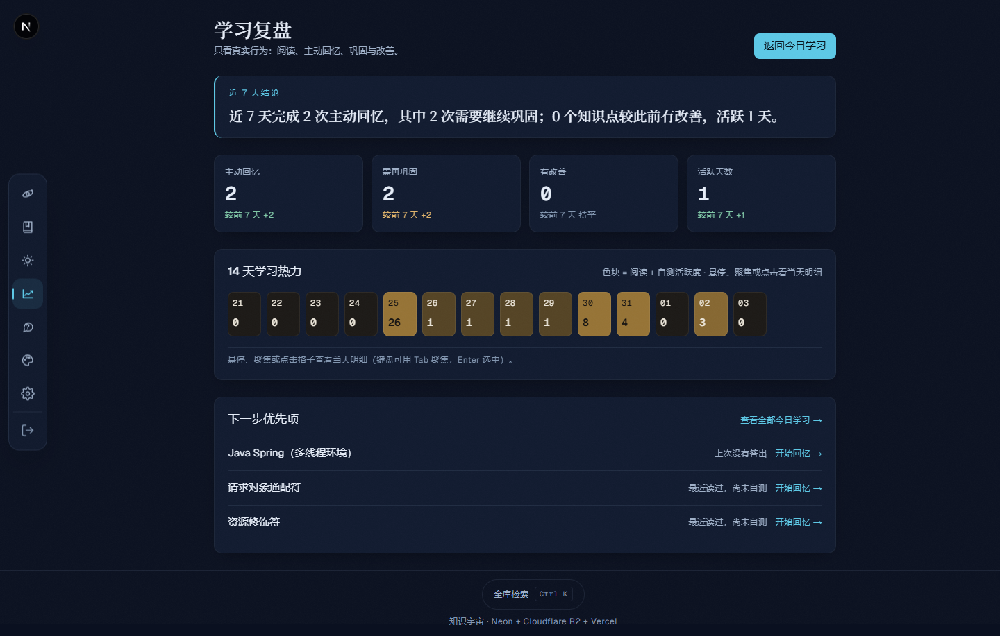

**图 7｜`/progress`**：近 7 天结论、14 天热力、下一步优先项。

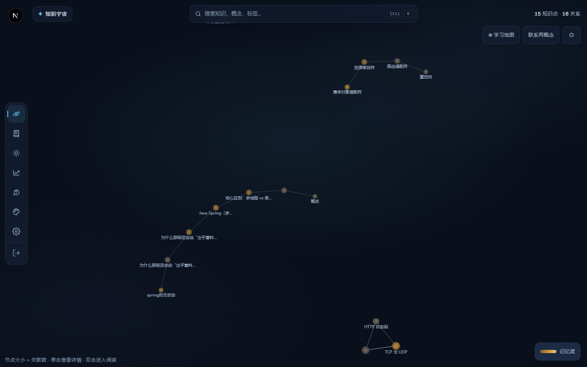

**图 8｜`/graph`**：节点亮度 = 记忆度，大小 = 关联数；顶部搜索、右侧动作簇与底部导航。

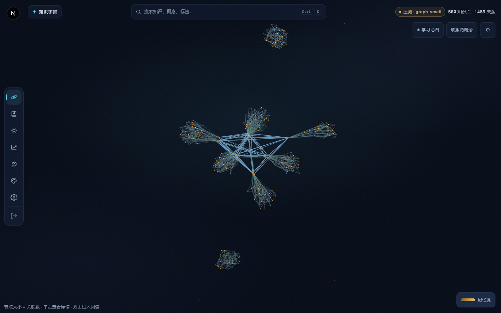

**图 9｜`/graph?fixture=graph-small`**：不碰真实库的压测形态。

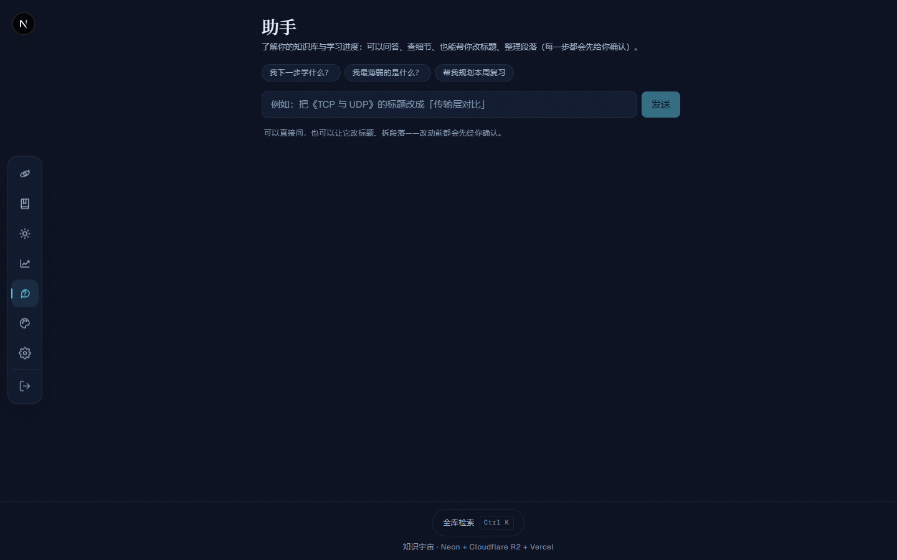

**图 10｜`/ask`**：多轮对话、上下文 chips、改动确认卡。

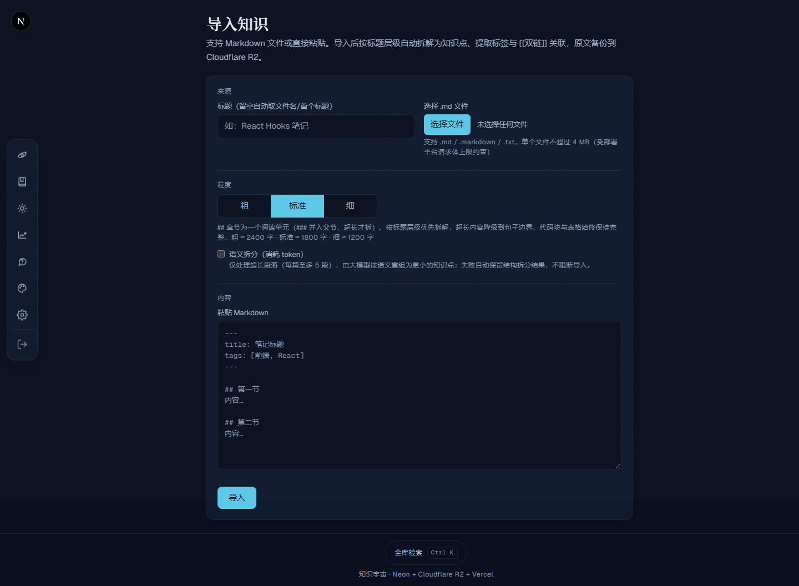

**图 11｜`/import`**：文件 / 粘贴、粒度三档、语义拆分开关。

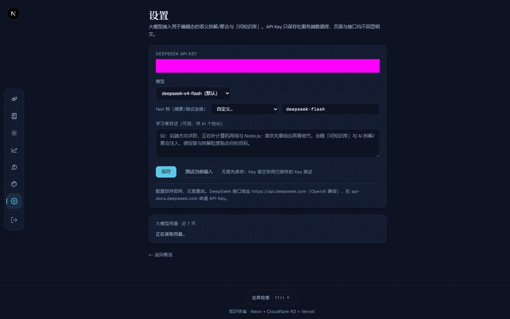

**图 12｜`/settings`**：Key 尾号、模型与 fast 档、学习者自述、近 7 天用量。

### 10.2 移动端全貌（10 张，索引）

`mobile-login` 无对应全页图；已有 10 张移动端全貌截图位于同一目录：`mobile-dashboard-full.png`、`mobile-notes-full.png`、`mobile-note-detail-full.png`、`mobile-segment-detail-full.png`、`mobile-study-full.png`、`mobile-progress-full.png`、`mobile-graph-full.png`、`mobile-ask-full.png`、`mobile-import-full.png`、`mobile-settings-full.png`。举两例：

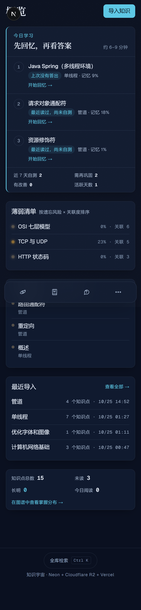

**图 13｜移动端 `/`**：底部导航条、单列卡片布局。

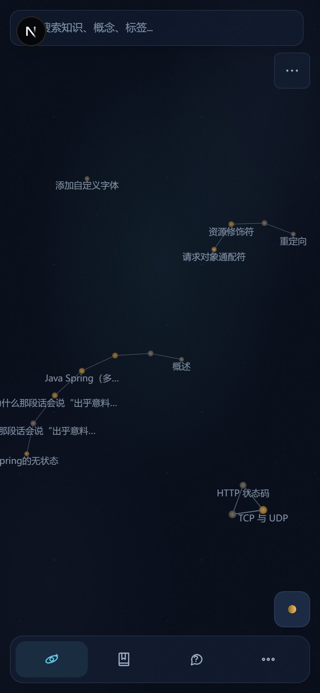

**图 14｜移动端 `/graph`**：顶栏搜索、折叠图例与底部导航。

### 10.3 高清原图索引（`images/`，20 张）

| 文件 | 对应页面 / 场景 |
|---|---|
| `01-login.png` | 登录页（唯一登录图） |
| `02-graph.png`、`03-graph-search.png`、`04-graph-detail.png`、`05-graph-compare.png`、`06-graph-theme.png` | 图谱总览、搜索、详情、双选、主题 |
| `07-graph-fixture-small.png`、`08-graph-fixture-mid.png`、`09-graph-fixture-large.png`、`14-graph-fixture-large.png` | 三档压测形态与另一批次 large 采集 |
| `10-dashboard.png`、`11-notes.png`、`12-note-detail.png`、`13-segment-detail.png`、`14-progress.png` | 概览、列表、文档阅读、知识点详情、复盘 |
| `15-study.png`、`16-study-reveal.png`、`17-ask.png`、`18-import.png`、`19-settings.png` | 主动回忆两态、助手、导入、设置 |

`handoff/screenshots/` 的 17 张 JPG 与这些原图的对应关系见 [handoff/README.md](./handoff/README.md) §3；单文件离线版见 [handoff/index.html](./handoff/index.html)。

> 所有截图均来自本地真实运行实例，非占位图。本文未采集生产环境数据；截图中的样例数据不等同于当前数据库内容。

---

## 11. 文档体系、整理记录与清单

### 11.1 文档地图与相互关系

| 文档 / 目录 | 定位 | 被谁引用 / 引用谁 |
|---|---|---|
| [README.md](./README.md) | **唯一文档索引**：命名、格式、维护约定、归档策略 | 被 6 处引用；指向下列全部现行文档 |
| [快速开始.md](./快速开始.md) | 安装、迁移、启动、验证、脚本表 | 被 README 与各文档引用；指向配置说明、排查 |
| [配置说明.md](./配置说明.md) | 环境变量、认证、LLM、R2、缓存、fixture、偏好 | 被 README、快速开始引用 |
| [功能说明.md](./功能说明.md) | 逐页功能、交互、入口文件、接口对照 | 被 12 处引用，是页面级事实的主要出处 |
| [常见问题排查.md](./常见问题排查.md) | 启动 / 构建 / 登录 / 数据库 / 图谱 / LLM / E2E 排查 | 被 README、快速开始引用；承接 `archive/排查-原始审计` 的结论 |
| [spec.md](./spec.md) | 产品设计、关键决策、数据模型 | 被 README、维护约定引用 |
| [未完成任务清单.md](./未完成任务清单.md) | 任务台账（**状态权威**）、开放项、决策项、变更记录；§8 为本轮迭代批次登记与 T01–T25 / Q1–Q3 状态追踪 | 被 22 处引用，是台账中心 |
| [执行版任务清单.md](./执行版任务清单.md) | 本轮迭代执行分发版任务书 **v1.2 · 冻结版**（**定义权威**）：六阶段与依赖图、全局约束（含 Git 改动保护）、T01 四张矩阵、状态语义表、两层状态模型、原型交付约定、28 个任务七字段定义 | 由 §11 索引；任务定义只在此维护，状态由协调 Agent 回填到台账 §8 |
| [迭代方向.md](./迭代方向.md) | 2026-11-04 产品设计方向 v1.0：目标、范围与约束 | 执行版任务清单的源文档 |
| [任务拆解建议.md](./任务拆解建议.md) | 对任务清单的工程化校准建议（8 项问题、依赖调整、v1.1 口径） | 执行版任务清单的校准依据 |
| [项目全景说明.md](./项目全景说明.md)（本文） | 面向外部 LLM 的单文件全景 + 文档关系总图 | 引用 README、plans、handoff、images、archive；被 README §6.2 引用 |
| [前端缺陷清单与修复方案.md](./前端缺陷清单与修复方案.md) | 2026-11-02 缺陷台账与 T1–T10 修复方案 | 历史台账；与 11-03 审计报告互为补充 |
| [plans/](./plans) | 6 个专项迭代计划 + 1 个全站质量审计 | `knowledge-universe-tasks.md`、`systematic-iteration-plan.md` 引用 `archive/GPT建议.md` 等历史快照 |
| [plans/frontend-quality-audit.md](./plans/frontend-quality-audit.md) 与 `frontend-quality-audit-evidence/` | 11-03 审计报告 + 全页全貌截图、JSON 数据 | 为本文 §10 提供主配图 |
| [archive/](./archive) | 12 份带横幅或不带横幅的历史快照 | 被 `plans/knowledge-universe-tasks.md`、`systematic-iteration-plan.md`、`handoff/project-dossier.md` 引用；**不可整体删除** |
| [handoff/](./handoff) | 交接包：`project-dossier.md`（主文档）、`README.md`、`cleanup-report.md`、`index.html`、`build-index.mjs`、`screenshots/` | dossier 引用 `archive/排查-原始审计`；README 映射截图；cleanup-report 记录清理 |
| [images/](./images) | 20 张高清原图 | 被 `handoff/README.md` §3 映射、本文 §10.3 索引 |

**阅读路径**：第一次运行 → 快速开始 → 配置说明 → 常见问题排查；了解能做什么 → 功能说明；讲给外部 AI → 本文 或 `handoff/project-dossier.md`；一次性上传 → `handoff/index.html`；接手未完成工作 → 未完成任务清单 → plans；**按编号执行本轮迭代 → 执行版任务清单（状态回填到台账 §8）**；理解取舍 → spec。

### 11.2 2026-11-04 删除清单及判定依据

共删除 **16 个文件**（`docs/` 从 189 个文件收敛为 173 个）。所有文件删除前已备份至项目外临时目录 `C:\Users\blank\AppData\Local\Temp\kb-docs-cleanup-20261104\`；`docs/images/` 的 11 张 PNG 由 git 跟踪，可用 `git restore <路径>` 恢复；三份归档副本的原路径文件仍可由 `git show HEAD:<原路径>` 取回。

| # | 删除路径 | 类别 | 判定依据 | 可恢复性 |
|---|---|---|---|---|
| 1 | `archive/GPT建议-根目录旧版-2026-11-02.md` | 重复 | 与 `archive/GPT建议.md` 内容重复（仅缺归档横幅、标题层级不同）；后者带规范横幅且被 `plans/knowledge-universe-tasks.md` 引用；本副本 0 引用 | `git show HEAD:docs/GPT建议.md` + 备份 |
| 2 | `archive/project-context-根目录旧版-2026-11-02.md` | 重复 | 与 `archive/project-context.md` 内容重复（差异仅目录树注释一行与归档横幅）；后者带横幅且被 `plans/` 引用；本副本 0 引用 | `git show HEAD:docs/project-context.md` + 备份 |
| 3 | `archive/排查-并入常见问题排查-2026-11-02.md` | 重复 | 与 `archive/排查-原始审计-2026-10-29.md` 除归档横幅 5 行外逐行相同；后者被 `handoff/project-dossier.md` 引用；本副本 0 引用 | `git show HEAD:docs/排查.md` + 备份 |
| 4 | `plans/frontend-quality-audit-evidence/flows-deep.partial.json` | 重复过程产物 | 与全量 `flows-deep.json` 的键集合与各键值**完全一致**，为审计中断时的中间快照 | 全量文件保留 + 备份 |
| 5 | `plans/frontend-quality-audit-evidence/graph-deep.partial.json` | 重复过程产物 | 与全量 `graph-deep.json` 逐键值完全一致 | 全量文件保留 + 备份 |
| 6–16 | `images/02-dashboard.png`、`03-notes.png`、`04-note-detail.png`、`05-segment-detail.png`、`06-graph.png`、`09-progress.png`、`10-study.png`、`10b-study-reveal.png`、`11-ask.png`、`12-import.png`、`13-settings.png` | 过时重复配图 | 均为 15:34 旧批，同页面已有 15:55 现行批 PNG；`handoff/cleanup-report.md` §4 明确建议「等全景说明重写图注后删除」；改图注后这 11 张**仅被本文旧版引用**，无其他引用 | `git restore` + 备份 |

**未删除的相近项及理由**：`archive/` 中 6 个 `*-根目录旧版-2026-11-02.md` 计划副本虽与 `plans/` 近似，但与现行版存在 3–89 行实质差异，属有追溯价值的历史版本，且是 README §6.1 记录的归档产物；`archive/knowledge-universe-roadmap` 等 3 份实验/差距分析为独立历史资料；`images/01-login.png`（唯一登录图）、`07`/`08`/`14`（压测补图，其中 `14` 与 `09` 内容不同）均有独立价值。

### 11.3 保留清单（按目录）

| 目录 | 保留内容 | 数量 |
|---|---|---|
| `docs/` 根 | `README.md`、`项目全景说明.md`、`快速开始.md`、`配置说明.md`、`功能说明.md`、`常见问题排查.md`、`spec.md`、`未完成任务清单.md`、`前端缺陷清单与修复方案.md`、`迭代方向.md`、`任务拆解建议.md`、`执行版任务清单.md` | 12 个 md |
| `docs/archive/` | `GPT建议.md`、`project-context.md`、`排查-原始审计-2026-10-29.md`（带横幅正式快照）+ 6 个计划旧版副本 + 3 份实验/路线/差距分析 | 12 个 md |
| `docs/plans/` | `graph-performance-plan.md`、`knowledge-universe-tasks.md`、`llm-optimization-plan.md`、`systematic-iteration-plan.md`、`ux-optimization-plan.md`、`visual-iteration-plan.md`、`frontend-quality-audit.md` | 7 个 md |
| `docs/plans/frontend-quality-audit-evidence/` | 全页全貌截图与非全页证据图、审计 JSON（含全量结果） | 93 张图 + 10 个 JSON |
| `docs/handoff/` | `README.md`、`project-dossier.md`、`cleanup-report.md`、`index.html`、`build-index.mjs`、`screenshots/*.jpg` | 5 个文件 + 17 张 jpg |
| `docs/images/` | 现行批 16 张 + 登录页与压测补图 4 张 | 20 张 PNG |

### 11.4 引用一致性校验

- 全量扫描 `docs/**/*.md` 的相对链接：**0 断链**（2026-11-04 复核，链接总数随文档增删变化，以当次扫描为准，见 §12）。此前一度缺失的 5 份现行文档已由用户还原，新增的 `执行版任务清单.md` 及其交叉引用均可解析。
- `README.md` §1 文档地图、§6.1/§6.2 归档记录、`handoff/cleanup-report.md` §8 已同步为整理后状态。
- `handoff/README.md` §3 的 17 张截图映射、`handoff/project-dossier.md` 的图片与归档引用，均指向仍存在的文件。
- `README.md` §4 维护约定引用的本文 §2.1、§5.1、§6.2、§10、§11 章节号在重写后保持不变。

---

## 12. 给外部 AI 的最小使用建议

- 想理解产品：读 §1 + §10 图 2 / 图 6 / 图 7 / 图 8。
- 想复现项目：按 §3 命令 + §2.2 环境变量；注意 `npm run build` 需要 `DATABASE_URL`。
- 想改代码：先读 §5.1 路由表定位入口，再读 §4.2 模块表与 §6.2 表结构，遵守 §7 铁律；涉及 Next 16 API 时先查 `node_modules/next/dist/docs/`。
- 想评估进度：读 §9 与 [未完成任务清单.md](./未完成任务清单.md)；不要用本文摘要替代台账细节。
- 想核对文档现状：读 §11（文档关系、删除与保留清单、一致性校验），索引以 [README.md](./README.md) 为准。
